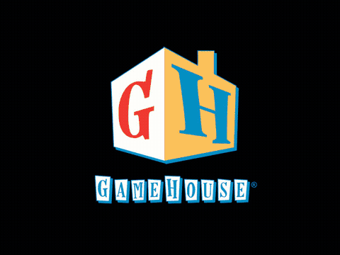

# re-twist-tt2

A native desktop recreation of **Text Twist 2** (GameHouse, 2008) in
portable C++17.

The original shipped a 25 k-word English word list and a 117 k-word full
list, both locked behind a Win32 installer. This project extracts the
game logic, decodes the dictionary format, and ships with a public-domain
**2008 → 2026 dictionary update** (ENABLE2k, 173 528 words) — drop-in
replaceable with no engine change.

The whole thing builds with CMake and runs on Linux, macOS and Windows.
There is no web layer, no JavaScript, no Capacitor.

## Work in progress: the boot sequence



Splash, loading screen and main menu rebuilt 1:1 from the decompiled
original (timings in `docs/reverse-engineering/welcome-flow.md`),
recorded with `tt2 --dump-frames` at 4x speed. The art shown comes from
a legitimately owned copy imported with `scripts/import-original.sh`;
the repository ships only procedural placeholders.

## Quick start

```bash
cmake -S . -B build
cmake --build build -j
ctest --test-dir build --output-on-failure
./build/tt2_engine data/open-common.tree data/open-full.tree
```

## What's in the box

- **`engine/`** — header-only C++17 engine. The LCG, the `.tree` format,
  the bag, the board, the scoring, the per-mode round state. Same logic
  as the original binary (see `docs/reverse-engineering/`), no
  GameHouse-specific types.
- **`src/main.cpp`** — small driver that exercises the engine.
- **`tools/tree_cli.cpp`** — `decode`, `encode`, `merge`, `diff`,
  `verify` for the `.tree` dictionary format.
- **`data/`** — runtime dictionaries. `open-common.tree` (22 460
  words) and `open-full.tree` (173 528 words) are committed.
- **`data-src/`** — raw word lists (ENABLE2k, frequency lists) for
  rebuilding the open dictionaries.
- **`docs/reverse-engineering/`** — the binary fingerprint, gameplay
  notes, and the `.tree` format spec; the evidence behind the
  reconstruction.
- **`CMakeLists.txt`** — the build.

## Goals

- **Update the dictionary.** 2008 → 2026, with the public-domain
  ENABLE2k list as the new common source. No engine change required to
  swap dictionaries.
- **Run on Linux, macOS, Windows.** Header-only engine, no Win32 / no
  GameHouse GF2 / no C++Builder. The CLI driver runs everywhere.
- **Faithful to the original rules.** Scoring, the bag, the
  48-slot cap with per-length quota, the Java LCG, the WOTD day
  index — all bit-exact matches to the original binary's behaviour.

## What this isn't (yet)

- It is not a UI. The original uses GameHouse's GF2 engine + Borland
  VCL + a custom bitmap-font renderer; the next milestone is a native
  UI layer (SDL2 + SDL2_ttf + SDL2_mixer) on top of the existing
  engine.
- It is not a complete port. The Crossword scene (`CrisscrossScene`),
  the trophy _conditions_ and the settings dialogs are not in this drop.
  The dictionary file, the LCG, the bag and the per-mode scoring are the
  parts that change with the dictionary; the rest is a thin VCL window
  wrapper.

## Layout

```
.
├── CMakeLists.txt
├── README.md
├── CLAUDE.md
├── engine/
│   ├── include/tt2/        # header-only engine
│   └── tests/              # C++ unit tests (no external deps)
├── src/
│   └── main.cpp            # driver / smoke test
├── tools/
│   └── tree_cli.cpp        # dictionary CLI
├── data/                   # runtime .tree dictionaries
├── data-src/               # raw word lists
├── docs/
│   ├── reverse-engineering/  # binary fingerprint, gameplay notes
│   ├── design/             # original-look brief (kept for the future UI)
│   └── dictionary-sources.md
└── Text Twist 2.exe -> /home/deck/.temp/Text Twist 2.exe   (gitignored)
```

## Legal

Look and feel may imitate the original; assets may not. The shipped
dictionaries are public-domain or CC BY-SA 4.0. The original GameHouse
`.tree` files and the executable are not committed. The DRM components
(`texttwist2_RADRM.dll`, trial code, `.nfo` files) are not analyzed.

## Status

- Engine: complete for Classic (Timed/Untimed/WOTD) and Lightning
  scoring; rack pick, board, slot cap, guess check, scoring — all
  unit-tested.
- Dictionary: open `.tree` files committed and verified round-trip
  byte-identical against the build pipeline.
- UI: SDL2 front end boots splash → loading → main menu with the
  original timings (`ui/`). Menu buttons react but no mode starts yet;
  the player-name label needs the bitmap-font renderer.
- Crossword: grid, placement loop and scoring in
  `round_crossword.hpp`, reconstructed from confirmed decompilation.
- Profiles: player list (5 max, 15-char names, exact-duplicate check),
  per-player progression (bag seed/index, WOTD day, max length, 24
  trophy slots, counters) and the five high-score tables with the
  original insert/trim and default-fill rules, in `profile.hpp`;
  plain-text save files in `profile_store.hpp`. Spec:
  `docs/reverse-engineering/profiles.md`. Not wired to the UI yet.
