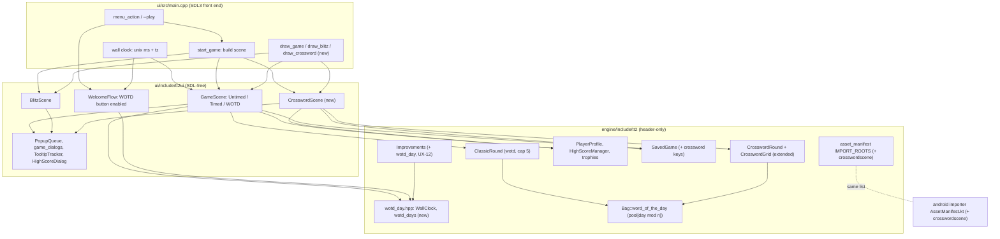
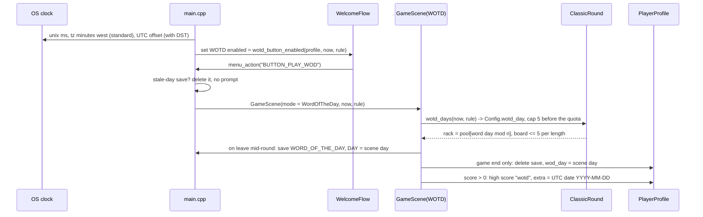
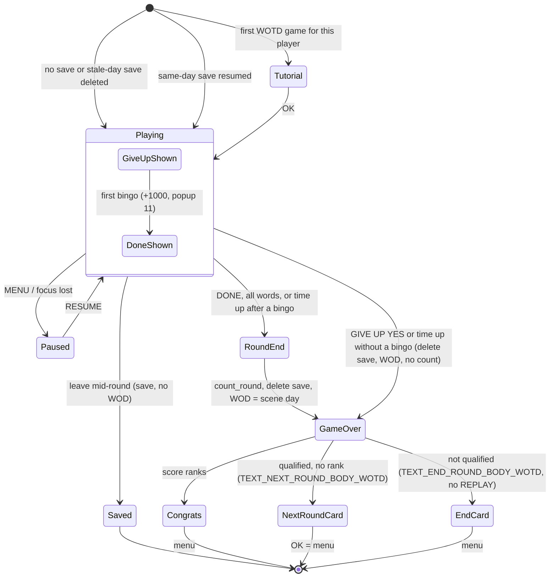
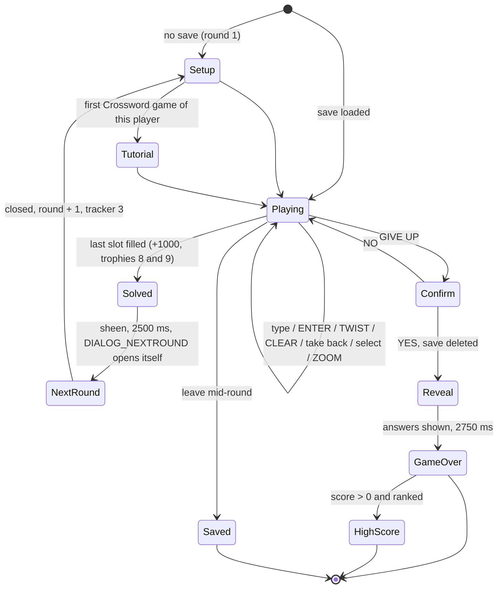
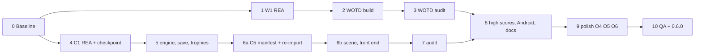

# Word of the Day and Crossword (0.6.0)

Claude (Opus 5.5) drafted this design on 2026-10-22 from the user's brief, the requirement analysis, and a read of
the repository at `develop` (`b692fb4`). Status: **Approved** (2026-10-22), in implementation. Target release:
**0.6.0** (Android port + Word of the Day + Crossword + the untimed-polish leftovers, one release).

Tags used below, same as the reverse-engineering (RE) docs: **CONFIRMED** (read in code or shipped XML),
**INFERRED** (strong reading, not proven), **UNKNOWN** (not found yet). An acceptance criterion marked
**(refined after W1)** or **(refined after C1)** waits on that REA task; it is written from what the repo already
knows and gets its final numbers from the REA output.

No ADR and no PRD (user decision: follow the Lightning precedent, `docs/plans/lightning-rea.md` and
`docs/plans/lightning-gaps.md`). Decisions are recorded here in [Decisions](#decisions).

## Design summary (meta)

```yaml
design_type: extension          # two new modes on the existing engine and scene framework
complexity_level: high
complexity_rationale:
  requirements_and_acs:
    - "WOTD has three clocks (UTC word day, local standard-time scene day, UTC high-score date), an IMPROVEMENTS
      switch to the local day, a same-day resume and a single round with two end cards (AC-W3..W8, AC-W11)"
    - "Crossword needs a new scene model, a grown save format and a manifest change (AC-C1..C14, AC-C9, AC-C11)"
  constraints_and_risks:
    - "Crossword gameplay past the grid builder is unknown until C1 (R1)"
    - "The manifest change forces one re-import on every desktop and Android device (R3)"
    - "The GameScene constructor change ripples through 113 tests and main.cpp (R5)"
    - "REA must stay on scene code and stop at the DRM boundary (R9)"
main_constraints: [header-only pure engine, SDL-free models, no original assets in git, user commits and tags]
biggest_risk: Crossword unknowns (R1)
unknowns: [OI-3, "game-scene.md §8.8 UNCONFIRMED rows: popup 11 timing, reveal-exit edge, LCG after the reseed"]
```

## Orientation

- **What these modes are.** Text Twist 2 has five modes on its main menu. Untimed, Timed and Lightning are
  playable in the port. **Word of the Day (WOTD)** is a Classic round whose rack word depends only on the date,
  so every player gets the same word that day. **Crossword** (the original calls it `CrisscrossScene`) lays the
  rack's sub-anagrams out as an 18×11 crossword grid and the player fills it in.
- **Where the code lives.**
  - `engine/include/tt2/` is the header-only engine. The WOTD rack pick (`bag.hpp`), the WOTD board cap
    (`round_classic.hpp`, `board.hpp`) and the Crossword grid builder (`round_crossword.hpp`) already exist and
    are unit tested. Nothing in the UI calls the WOTD or Crossword parts yet.
  - `ui/include/tt2ui/` holds the SDL-free scene models. `game_scene.hpp` is the Classic scene (Untimed and
    Timed); `blitz_scene.hpp` is Lightning. There is no Crossword scene.
  - `ui/src/main.cpp` is the SDL3 front end that draws the models and routes input.
  - `android/` wraps the same CMake build; its Kotlin importer has a twin of the asset manifest rules.
- **How a click reaches the code.** The main menu (`welcome_flow.hpp`, `SelectionScene`) turns a click into a
  button name and calls `services.menu_action(name)` in `main.cpp`. For a playable mode that calls
  `request_game(GameMode)`, which asks "Continue the game?" when a save exists, then `begin_game(mode)` fades to
  black, and the fade's end builds a `GameScene` or `BlitzScene`.

`ui/src/main.cpp:2628-2649` (current)

```cpp
services.menu_action = [&](const std::string& name) {
    if (name == "BUTTON_QUIT") running = false;
    // ...
    else if (name == "BUTTON_PLAY_UNTIMED") request_game(tt2::GameMode::Untimed);
    else if (name == "BUTTON_PLAY") request_game(tt2::GameMode::Timed);
    else if (name == "BUTTON_BLITZ") request_game(tt2::GameMode::Blitz);
    // ...
    else std::printf("menu: %s (not implemented yet)\n", name.c_str());
};
```

`BUTTON_PLAY_WOD` and `BUTTON_CRISSCROSS` fall through to the last line.

## Problem

- **What the player sees.** The WORD OF THE DAY and CROSSWORD buttons on the main menu light up on hover and play
  the click sound, then nothing happens. The console prints `menu: BUTTON_PLAY_WOD (not implemented yet)`. The
  HIGH SCORES dialog has WOTD and Crossword tabs that can only ever show the ten prefilled names, and the
  **Well Rounded / Maniac / Fanatic** trophies can never be won, because they need a finished round in all five
  modes (`trophies.hpp:113`, `count_round`).
- **Technical cause.**
  1. No menu branch for the two buttons (above).
  1. `GameScene` only knows Timed vs Untimed: its constructor takes `bool timed` (`game_scene.hpp:469-472`), and
     `mode()` maps that bool to two modes only (`game_scene.hpp:1291`). It also starts every round with
     `round_->start(rng_, bag_, 0)` (`game_scene.hpp:880`), and that third argument is the clock in ms that WOTD
     needs; `0` would make the day index `-14125`.
  1. The WOTD menu button is never disabled: `PlayerProfile::played_wod_today` (`profile.hpp:97`) has no caller,
     and nothing in `ui/` reads the wall clock.
  1. There is no Crossword scene model, no Crossword drawing code, and the six `images/crosswordscene` files are
     not in the import manifest (`asset_manifest.hpp:33`, `AssetManifest.kt:19`).
  1. Crossword gameplay past the grid builder and the scoring (`round_crossword.hpp:247`) has not been reverse
     engineered: layout, input, Zoom, timer, round end, save keys and trophies are unknown.

## Agreement checklist

| # | Agreement (user, binding) | Where it is reflected |
| --- | --- | --- |
| A1 | One release, **0.6.0**: Android + WOTD + Crossword + polish. The manifest grows, so players re-import once | [Phases](#implementation-phases) Phase 10; AC-X1, AC-X5; Risk R3 |
| A2 | Untimed polish (O4 animation inventory, O5 rack deal order, O6 ROADMAP refresh) goes **after** the modes | Phase 9; AC-P1..P3 |
| A3 | No ADR, no PRD, no acceptance-test skeletons; every task ships its own positive and negative unit tests | This doc; [Verification](#verification-strategy) |
| A4 | WOTD day rule: **match the original after REA**, and keep counting days from 2008-09-03 up to today (the pool wraps) | [WOTD day rule](#wotd-day-rule); Open item OI-1 |
| A5 | Crossword keeps the original layout and its Zoom button; Android touch changes only if device tests show a need | [Crossword design](#crossword-design); OI-6 |
| A6 | Both modes are **import-only** (no placeholder art) | Non-goals; AC-C11 |
| A7 | `DialogPause` (`p` key) stays a documented deviation | Non-goals |

Constraints carried from `CLAUDE.md`: no DRM / trial / `.nfo` analysis (REA stays on scene functions); never commit
original art; engine header-only and pure; UI models SDL-free; trees outlive rounds (ASan); every RE constant
tagged with an evidence id; the AI stages and drafts commits, the user commits, pushes and tags.

Performance: no target. Both modes build one round at a time with code that already runs in Classic and in the
engine tests. Nothing here is measured beyond "the round appears without a visible stall", checked by hand on the
Android tablet (T6.1).

Contradictions found: none. One process discrepancy is reported in [Prerequisite ADRs](#prerequisite-adrs).

## Scope

In scope:

- **W1-W5**: WOTD REA, engine check, `GameScene` WOTD mode, menu wiring, audit.
- **C1-C8**: Crossword REA (new `docs/reverse-engineering/crossword.md`), engine extension, `CrosswordScene`
  model, front end, manifest, save and resume, trophies, audit.
- **X1-X4**: high-score tabs, Android checks (with the Android plan's open T6.1 device checklist and Phase 6 QA),
  docs, release 0.6.0.
- **O4-O6**: polish phase (animation inventory REA, original rack deal order, ROADMAP refresh).

## Non-goals

| Id | Item | Why it is out |
| --- | --- | --- |
| O3 | Emulator smoke test in CI | Real-device T6.1 covers this release; an emulator job is its own CI work |
| O7 | `DialogPause` on the `p` key | User decision A7: documented deviation (`game-scene.md` §6) |
| O8 | AppImage / Steam Deck manual import check | User-only check; listed in Phase 10 as a manual step, not a design item |
| O9 | Placeholder art for any mode | A6; the import is required today anyway |
| O10 | "Don't remind me" on the import prompt | Unrelated UX item |
| O11 | Minor RE loose ends outside these two scenes | Each is tiny; batching them would blur the evidence trail |
| O13 | Legacy Edition (Android 5-11), gamepad, web build | Separate projects |
| - | Same WOTD word as the 2008 game for a given date | The open dictionary has a different pool; see [Deviations](#deviations) D1 |
| - | Exact Crossword grid parity with the original | Impossible: the exe seeds the CRT from the clock (`crossword.md` §9); OI-3 |

## Prerequisite ADRs

- `docs/adr/` does not exist; there are no common ADRs.
- **Discrepancy, reported on purpose:** the documentation criteria call for an ADR at 6+ files. This change touches
  about 38. The user chose no ADR, following the Lightning precedent (`338d443`, `d9361c8`), so the decisions live
  in [Decisions](#decisions). No new common technical area (logging, error format, contract style) is introduced,
  so no common ADR is needed either.

## Applicable standards

| Standard | Kind | Source |
| --- | --- | --- |
| Engine is header-only, pure, unit tested; positive and negative tests per change | [explicit] | `CLAUDE.md` Working rules |
| UI models in `ui/include/tt2ui/` stay SDL-free | [explicit] | `CLAUDE.md` Working rules |
| `WordTree` pointers are non-owning; trees outlive rounds; ASan enforces it | [explicit] | `CLAUDE.md`, CI `asan-ubsan` job |
| Every RE constant has CONFIRMED / INFERRED and an evidence id or address | [explicit] | `CLAUDE.md` Reference section |
| Never commit original assets; no DRM / `.nfo` analysis | [explicit] | `CLAUDE.md` Legal boundary |
| Import text only in `import_prompt.hpp` | [explicit] | `CLAUDE.md`, `ImportTextTest` |
| Conventional Commits; AI stages and drafts with `Co-Authored-By`; user commits and tags | [explicit] | `CLAUDE.md` |
| SemVer before 1.0: any `feat` or save-format change is MINOR | [explicit] | `CLAUDE.md` Releases |
| Coverage of new code at least 95% | [explicit] | User's global rules |
| Deviations from the original are labelled `DEVIATION` / `Deviation (X-n)` in code comments and listed in the RE doc | [implicit] | `game_scene.hpp:965`, `welcome_flow.hpp:330` |
| Code comments cite the original address of each rule (`// 0x4110f0: ...`) | [implicit] | every scene header |
| A scene model has the `BlitzScene` shape: `(common, full, profile, highscores, Services, seed, resume)` | [implicit] | `blitz_scene.hpp:239` |
| The front end drives scenes by duck typing through `with_play` (same member names on every scene) | [implicit] | `main.cpp:2393` |
| One test file per header, registered by hand in `CMakeLists.txt` | [implicit] | `CMakeLists.txt:235-298` |
| Save files are our own text format; keys mirror the original's names; unknown keys fail the parse | [implicit] | `saved_game.hpp:16-17`, `:133` |
| RE findings go to `docs/reverse-engineering/*.md`; the working REA plans go to `docs/plans/` (gitignored) | [implicit] | `.gitignore:69`, `lightning.md` |

The implicit rows need the user's confirmation before Phase 2 starts (OI-9). Every design choice below follows them
with one deviation: `CrosswordScene`'s constructor is the `BlitzScene` shape **plus a `CrtRandom&`** (D-11), because
the original's CRT `rand()` state outlives a scene. OI-9 lists it for confirmation. T9.3b later gave `GameScene` and
`BlitzScene` the same argument, because the original deals every rack from that CRT too.

## Quality assurance mechanisms

| Mechanism | Status | Note |
| --- | --- | --- |
| `-Werror` on GCC / Clang (`CMakeLists.txt:51`) | adopted | New headers compile warning-free |
| `ctest`: `tt2_unit_tests` + `tt2_ui_unit_tests` | adopted | Both grow |
| CI `asan-ubsan` job (`ci.yml:38-40`, headless, UI off) | adopted | Catches tree lifetime bugs in the new scene |
| CI Windows MSYS2 job (builds `gnu++20` by default) | adopted | New code must compile under C++17 and C++20 |
| CI headless smoke run and `scripts/ci-import-smoke.sh` | adopted | The smoke import must pass with the grown manifest |
| `engine/tests/test_asset_manifest.cpp` (roots, rules) | adopted | Extended for `images/crosswordscene` |
| Android `./gradlew testDebugUnitTest` | adopted | Kotlin manifest twin |
| `scripts/ci-apk-check.sh` against `data/original-assets.sha256` | adopted | The APK must not carry any of the 6 new hashes |
| `grep -rn SDL ui/include/` returns nothing | adopted | Manual gate in each audit phase |
| `rumdl` on changed Markdown (installed locally, no repo config) | adopted | Run by hand; not in CI |
| Coverage tooling | noted | No coverage job exists. Measured once with `gcovr` in a scratch build in Phase 10 |
| `tt2-tree verify` | noted | No dictionary change |
| `tools/gen_placeholders.py` | noted | No placeholder art (A6) |

## Existing codebase analysis

### Corrections to the brief (verified 2026-10-22)

- The CLI flag is **`--play`**, not `--auto-play` (`main.cpp:1993`, `:2027`). Today it takes `untimed`, `timed`,
  `lightning`; any other value starts Untimed (`main.cpp:2534-2536`). This design adds `wotd` and `crossword`.
- **WOTD needs no manifest change.** `background_wotd.png`, `image_popup_11.png` and `button_wotd.png` are already
  in `data/original-assets.sha256`.
- **Crossword's `gamescene` art is already in the manifest** (`XwordBox.png`, `button_zoom.png`,
  `crosswordHighlight.png`, `letterBox_cword.png`, `letterBox_cwordhole.png`, `image_popup_4.png`,
  `sound/crossword_rotate_word.ogg`). Only the six files under `images/crosswordscene/` are missing: `background.png`,
  `btn_arrow_next.png`, `btn_arrow_prev.png`, `letterBar.png`, `letterBox.png`, `overlay.png` (file names only, read
  from the user's install and `resources.xml:283-289`).
- **No test keeps the two `IMPORT_ROOTS` lists equal.** The Kotlin list is a hand copy; nothing fails if they drift.
- The WOTD menu button already has its disabled sound (`welcome_flow.hpp:343-346`), but nothing ever sets it
  disabled.
- `GameScene` builds every round with clock `0` (`game_scene.hpp:880`), so turning on `cfg.wotd` alone would pick
  the word for day `-14125`.
- The tutorial texts for Crossword (index 3) and WOTD (index 4) are already in `game_dialogs.hpp:39-50`.
- `main.cpp` is 3,453 lines. `Assets` is defined inside it (`main.cpp:574`), so a separate `draw_crossword.cpp`
  would first need `Assets` moved to a header. See D-7.

### Implementation path mapping

| Path | State | Role in this change |
| --- | --- | --- |
| `engine/include/tt2/bag.hpp` (`word_of_the_day`, `:126`) | existing, changed | W2: drop the walk-forward past words with fewer than 15 sub-anagrams, keep the modulo (D-14); new `word_of_the_day_for_day(common, day)` |
| `engine/include/tt2/board.hpp` (`Board::build`, `:36-45`) | existing, **fixed** | W2: apply the 5-per-length cap **before** the 48-slot quota, like `0x4262b0` (D-13) |
| `engine/include/tt2/wotd_day.hpp` | **new** | `WallClock`, `WotdDayRule`, `wotd_days()`, civil date text; pure (D-15) |
| `engine/include/tt2/profile.hpp` (`wotd_day_from_unix`, `:54`; `played_wod_today`, `:97`) | existing, changed | `wotd_button_enabled(profile, WallClock[, rule])`; `wotd_day_from_unix` delegates to `wotd_day.hpp` |
| `engine/include/tt2/round_classic.hpp` (`Config::wotd`, `board_per_length_cap`) | existing, changed | `Config::wotd_day` (the word day the scene computed) |
| `engine/include/tt2/improvements.hpp` | existing, extended | `wotd_day=original\|local` (UX-12, D-12) |
| `ui/include/tt2ui/improvements_dialog.hpp` | existing, changed | DAILY WORD CLOCK row; `IMPROVEMENTS_ROW_H` 42 → 38 so 10 rows fit |
| `docs/design/improve-ui-ux.md` | existing, extended | UX-12 row in the deviations table |
| `engine/include/tt2/round_crossword.hpp` (`CrosswordRound`, `:247`) | existing, extended | Multi-round state, restore, rule gaps (C2) |
| `engine/include/tt2/saved_game.hpp` | existing, extended | Crossword fields (C6) |
| `engine/include/tt2/trophies.hpp` | existing, extended | Ids 8, 9 (C7) |
| `engine/include/tt2/asset_manifest.hpp` (`IMPORT_ROOTS`, `:33`) | existing, extended | `images/crosswordscene` (C5) |
| `ui/include/tt2ui/game_scene.hpp` | existing, changed | Mode instead of `bool timed`; WOTD branches (W3) |
| `ui/include/tt2ui/welcome_flow.hpp` | existing, changed | WOTD button enable state (W4) |
| `ui/include/tt2ui/crossword_scene.hpp` | **new** | SDL-free Crossword model (C3) |
| `ui/include/tt2ui/boot_preload.hpp`, `tooltip.hpp`, `scene_popups.hpp` | existing, changed | Crossword ids, popup kinds 4 and 11 |
| `ui/src/main.cpp` | existing, changed | Menu, `--play`, scene start, `draw_crossword`, wall clock (W4, C4) |
| `ui/tests/test_crossword_scene.cpp` | **new** | Scene tests |
| `android/.../importer/AssetManifest.kt` (`:19`) | existing, changed | Kotlin twin of the roots |
| `ui/tests/import-contract/import-roots.txt` | **new** | Shared list both test suites check (D-6) |
| `data/original-assets.sha256` | regenerated | +6 entries (325 lines today) |
| `docs/reverse-engineering/crossword.md` | **new** | C1 output |
| `docs/reverse-engineering/game-scene.md`, `gameplay-notes.md` | existing, extended | W1 output (WOTD section), O4 §9, O5 §4 |
| `CMakeLists.txt` | changed | New test file; version 0.6.0 |
| `CLAUDE.md`, `README.md`, `ROADMAP.md`, `trophies.md`, `profiles.md` | changed | X3, O6, C7 |

### Similar functionality search and decision

| Planned piece | Searched for | Found | Decision |
| --- | --- | --- | --- |
| WOTD rack | `word_of_the_day`, `WOTD_SEED` | `Bag::word_of_the_day` (`bag.hpp:126`); W1 found the exe takes `pool[day]` with no 15-sub-anagram walk (`game-scene.md` §8.2) | **Use existing, changed** (D-14) |
| WOTD board cap | `board_per_length_cap` | `Board::build(..., per_length_cap)` (`board.hpp:36`) caps after the 48 quota; the exe caps before (§8.3) | **Fix existing** (D-13) |
| WOTD day option | `Improvements`, `ImprovementsDialog` rows | 9 desktop rows, file ignores unknown keys | **Extend existing** (D-12) |
| WOTD scene | `TextTwist2Scene`, `timed_` | `GameScene` is the port of the one class that runs Untimed, Timed and WOTD (`game-scene.md:8`) | **Extend existing** (no new scene) |
| WOTD menu gate | `played_wod_today`, `disabled_sound` | Both exist, unwired | **Use existing**, wire it |
| WOTD high-score date | `HighScoreEntry::extra`, `highscore_strings::DATE` | Free-text `extra`, the dialog already shows "Date:" | **Use existing**; date format from W1 |
| Crossword grid and scoring | `CrosswordGrid`, `CrosswordRound` | `round_crossword.hpp`, 21 tests | **Use existing**, extend in C2 |
| Crossword scene | `CrisscrossScene`, `crossword_scene` | None | **New**, shaped like `BlitzScene` |
| Popups, dialogs, tooltips, trophy popup | `PopupQueue`, `game_dialogs.hpp`, `TooltipTracker` | Shared by Classic and Lightning | **Use existing** |
| Wall clock / time zone | `localtime`, `std::time`, `system_clock` | None in `ui/`, `engine/`, `src/` | **New**, in the front end only (D-3) |
| Manifest root parity C++ / Kotlin | `IMPORT_ROOTS` in tests | C++ test only | **New** shared fixture (D-6) |

No similar code was judged technical debt that needs an improvement proposal first.

### Dependency existence verification

| Assumed dependency | Result | Location |
| --- | --- | --- |
| `GameMode::WordOfTheDay`, `GameMode::Crossword` | verified | `profile.hpp:38` |
| `save_mode_name` `WORD_OF_THE_DAY`, `CRISSCROSS` | verified; the exe's tag is `CROSSWORD` (C1), so T5.2 renames it (OI-11) | `saved_game.hpp:33-42` |
| `SavedGame::day` | verified | `saved_game.hpp:52` |
| High-score tables `wotd`, `crossword` and dialog tabs | verified | `profile.hpp:40-49`, `highscore_dialog.hpp:66-72` |
| `count_round(PlayerProfile&, GameMode)` | verified | `trophies.hpp:113` |
| Trophy ids 8 (Puzzle Pro), 9 (Perfect Puzzler) | verified as ids; award functions **require new creation** | `trophies.md`, `trophies.hpp` |
| Tutorial texts index 3, 4 | verified | `game_dialogs.hpp:39-50` |
| `SoundId::ButtonWordOfTheDay` | verified | `welcome_flow.hpp:34`, `main.cpp:294` |
| `SoundId` for `SOUND_crossword_rotate_word` | **requires new creation** | resource exists (`resources.xml:37`) |
| `PopupKind` 4 (crossword intersection) and 11 (word of the day) | **requires new creation** (enum has 0-3, 5, 6, 8, 10) | `scene_popups.hpp:27-36` |
| `ImportStatus::Stale` | verified | `asset_import.hpp:142`, `:157` |
| `CrosswordScene`, `draw_crossword` | **requires new creation** | - |
| Original exe and `dialogs.xml` | external dependency (user's install, read-only) | `/mnt/c/Program Files (x86)/Games/Text Twist 2/` |
| Ghidra 12.1.4 + REA MCP | external dependency | user memory `ghidra-rea-setup` |

### Existing interfaces this change touches

```cpp
// ui/include/tt2ui/game_scene.hpp:469
GameScene(const tt2::WordTree& common, const tt2::WordTree& full, tt2::PlayerProfile& profile,
          tt2::HighScoreManager* highscores, bool timed, Services services, std::int64_t rng_seed,
          const tt2::SavedGame* resume = nullptr);
bool timed() const;                     // :483
const char* background_id() const;      // :531
tt2::GameMode mode() const;             // :1291 (private)

// engine/include/tt2/round_classic.hpp:46
Result start(Random& rng, Bag& bag, std::int64_t seed);   // `seed` is the WOTD clock in ms

// engine/include/tt2/round_crossword.hpp:312, :349
Result start(std::size_t round, Random& lcg, CrtRandom& crt, Bag& bag);
GuessReport guess(const std::string& raw);
```

Call sites: `GameScene` is built in `main.cpp:2701` and in the test fixture `test_game_scene.cpp:71` (113 tests go
through it). `CrosswordRound` is built only in `engine/tests/test_round_crossword.cpp`.

### Code inspection evidence

| File | Function / lines | Relevance |
| --- | --- | --- |
| `ui/src/main.cpp` | `menu_action` 2628-2649, `request_game` 2515, `menu_entered` 2532, scene start 2680-2712, `with_play` 2393, `--play` 2027 | integration point |
| `ui/src/main.cpp` | `draw_game` 1559, `draw_blitz` 1645, id tables 120-140, sound table 285-300, `Assets` 574 | pattern reference |
| `ui/include/tt2ui/game_scene.hpp` | ctor 469, `round_config` 871, `start_round` 878, `resume_game` 888, `scrambled` 965-976, `open_tutorial_once` 989 | integration point |
| `ui/include/tt2ui/blitz_scene.hpp` | ctor 239, `submit` 807, high score 953 | pattern reference |
| `ui/include/tt2ui/welcome_flow.hpp` | buttons 326-346, disabled click 408 | integration point |
| `ui/include/tt2ui/highscore_dialog.hpp` | `TABS` 66-72, `select` 176-180 | similar functionality |
| `ui/include/tt2ui/scene_popups.hpp` | `PopupKind` 27-36 | integration point |
| `ui/include/tt2ui/game_dialogs.hpp` | tutorial strings 39-50 | similar functionality |
| `engine/include/tt2/bag.hpp` | `word_of_the_day` 126-143, `WOTD_SEED` 39, `WOTD_EPOCH_DAY` 43 | similar functionality |
| `engine/include/tt2/profile.hpp` | `GameMode` 38, `wotd_day_from_unix` 54, `played_wod_today` 97, `submit` 324 | integration point |
| `engine/include/tt2/round_classic.hpp` | `Config` 28-34, `start` 46 | similar functionality |
| `engine/include/tt2/round_crossword.hpp` | `CrosswordRound` 247-394 | similar functionality |
| `engine/include/tt2/saved_game.hpp` | `save_mode_name` 33, `SavedGame` 45, `parse` 103 | integration point |
| `engine/include/tt2/trophies.hpp` | `count_round` 113, `award_lightning_round` 140 | pattern reference |
| `engine/include/tt2/asset_manifest.hpp` | `IMPORT_ROOTS` 33 | integration point |
| `android/.../importer/AssetManifest.kt` | `IMPORT_ROOTS` 19 | integration point |
| `docs/reverse-engineering/gameplay-notes.md` | §2 WOTD 103-110, §4 Crossword 211-243 | evidence |
| `docs/reverse-engineering/profiles.md` | §3.3 184-193 (menu day rule) | evidence |
| `docs/reverse-engineering/game-scene.md` | §1 29-35, §5 states 336-347, §5.1 popups 261-270, §7 saves 550-558 | evidence |
| Install `properties/dialogs.xml` | `SCENE_CRISSCROSS` lines 135-167 (read only) | evidence |
| Install `properties/resources.xml` | 34, 37, 195, 224-262, 283-289 (read only) | evidence |

### Fact disposition table

No Codebase Analysis input with `focusAreas` / `fact_id`s was provided, so there is no table. The existing-behaviour
facts this design relies on are listed in the two tables above with file and line.

## Decisions

| Id | Decision | Why this one | Rejected alternatives |
| --- | --- | --- | --- |
| D-1 | WOTD stays inside `GameScene`; the `bool timed` parameter becomes `tt2::GameMode mode` (Timed, Untimed or WordOfTheDay; anything else throws `std::invalid_argument`) | The original runs all three in one class (`TextTwist2Scene`); a WOTD subclass or copy would duplicate ~1,500 lines | A separate `WotdScene` (duplication); a second `bool wotd` (two bools can say "timed untimed WOTD") |
| D-2 | Reuse `tt2::GameMode` for the scene mode instead of a new enum | Semantic, responsibility and lifecycle fit all hold; `mode()` already returns it; high scores, tutorial flags and save names key on it | New `ClassicMode` enum (needs a mapping at every boundary) |
| D-3 | The wall clock is injected: `Services::now` returns `{unix_ms, tz_minutes_west}`; the front end fills it from the OS | Keeps the model SDL-free and lets tests pin any date and time zone | Calling `std::time` inside the model (untestable) |
| D-4 | By default copy the exe's **three clocks** (OI-1a, `game-scene.md` §8.1): **word day** = `floor(unix_s / 86400) - 14125` (UTC); **scene day** = `floor((unix_s - tz_min_west * 60) / 86400) - 14125` (local standard time, `dstflag` ignored), taken at round start and used for the menu gate, the save `DAY` and `player.WOD`; **high-score date** = the UTC calendar date at game over, `YYYY-MM-DD` | User decision OI-1a; A4 "match the original" | One shared day as the default (it is now the opt-in D-12) |
| D-5 | `CrosswordScene` is a new SDL-free model with the `BlitzScene` constructor shape plus `CrtRandom&` (D-11), and the member names `with_play` needs | Matches the two existing scenes; the front end keeps one dispatch lambda | Extending `GameScene` (the Crossword layout, grid and input have nothing in common with the slot table) |
| D-6 | `images/crosswordscene` is added to both `IMPORT_ROOTS`; a new shared fixture `ui/tests/import-contract/import-roots.txt` is read by the C++ and Kotlin tests so the lists cannot drift | The Kotlin list is a hand copy with no test today | Generating the Kotlin list from C++ at build time (more Gradle plumbing for one list) |
| D-7 | `draw_crossword` goes in `main.cpp` next to `draw_blitz` | `Assets` lives in `main.cpp`; moving it is a refactor of its own. OI-8 asks whether to do it after 0.6.0 | A new `ui/src/draw_crossword.cpp` now (needs an `assets.hpp` first) |
| D-8 | Crossword saves stay in `SavedGame` as new optional keys (the `blitz_words` precedent); the grid is stored as its placements, not re-generated | The grid uses CRT `rand()`, which cannot be replayed from a seed the port controls; storing placements is exact | Storing a seed and rebuilding (breaks if `CrtRandom` state differs); a new save struct (second parser) |
| D-9 | Save format stays `version=1`; new keys only appear in `CROSSWORD` saves | Old saves have none of the keys, so they parse as before | `version=2` (forces a migration path for no gain) |
| D-11 | One `CrtRandom` per process, owned by `main.cpp` and passed by reference to `CrosswordScene` and, since T9.3b, to `GameScene` and `BlitzScene` for the rack deal and TWIST (`tt2::deal_order`; non-owning; it outlives every scene, like the trees). Tests pass their own | The original's CRT `rand()` state is process-global: a second Crossword game in the same run continues the sequence; the exe seeds it once from the clock at start-up (`crossword.md` §9). See OI-3 | One `CrtRandom` per scene (restarts the sequence every game, which the exe never does) |
| D-10 | The original's on-disk save keys for Crossword are recorded by C1 for the RE doc (`crossword.md` §5.5), but the port's file stays our own text format. The save tag (mode name and file name) is `CROSSWORD`, like the exe (`0x590254`; OI-11, user T4.4) | Same as every other mode (`saved_game.hpp:16`) | Byte-compatible saves (no need: saves never move between the two games) |
| D-12 | IMPROVEMENTS gets a **DAILY WORD CLOCK** row, deviation **UX-12**: `Original` (default, D-4) or `Local time`, where the word, the menu gate, the save `DAY`, `player.WOD` and the high-score date all use the player's **local calendar day, with DST** | User decision OI-1a: faithful by default, a sane calendar on request | A settings.txt key (that file mirrors the original's settings only); no option (players in UTC+8 see the word change at 08:00) |
| D-13 | `Board::build` applies `per_length_cap` **before** the 48-slot quota (`0x4262b0` runs before `0x432330`) | W1 found the port's order can drop a WOTD length below 5 for racks with more than 48 common sub-anagrams | Leaving the order (a silent mismatch with the exe) |
| D-14 | `Bag::word_of_the_day` takes `pool[day mod n]` directly: **no** walk past words with fewer than 15 sub-anagrams (the exe has none), but the **modulo stays** (the exe has none either and reads out of range) | User decision OI-1b: EV-1 must match every day with the user's `common.tree`; the modulo keeps the open pool (19,181) and dates past 2069-01-14 / before 2008-09-03 safe | Keeping the walk-forward (differs from the exe on about one day in four); copying the out-of-range read (undefined behaviour) |
| D-15 | The day math lives in a new pure header `engine/include/tt2/wotd_day.hpp` (`WallClock`, `WotdDayRule`, `wotd_days()`, civil date) included by `bag.hpp`, `profile.hpp` and `improvements.hpp` | One place for three clocks and two rules; `improvements.hpp` must not include `profile.hpp` | Putting it in `profile.hpp` (pulls the whole profile into the improvements file) |
| D-16 | Crossword animates like the exe: the grid turns ±90° per selected word, pans (500 ms) and zooms (1000 ms) in Phase 6b; the INFERRED readings (popups 4 / 7 / 9, the 1000 / 500 / 1500 ms durations, Up / Down = zoom) are working assumptions until the T7.1 audit (user, T4.4) | Fidelity is the project's goal; the rotation is how the exe keeps the selected word next to its rack | Snap without animation now and animate in Phase 9 (rejected by the user) |

## Design

### Architecture



### Data flow: Word of the Day



### WOTD day rule

W1 (T1.1, `game-scene.md` §8.1) found three clocks in the exe; the port copies them by default (D-4):

| Use | Address | Formula | Clock |
| --- | --- | --- | --- |
| Which word | `0x43d690` | `pool[(uint32)time() / 86400 - 14125]` | UTC |
| Scene day `+0x1ec`: menu gate, save `DAY`, `player.WOD` | `0x425c50`, `0x42f1a0`, `0x42a460` | `((uint32)(_time64() - tz * 60)) / 86400 - 14125` | local standard time (`dstflag` never read) |
| High-score date | `0x43ff60` | `GetSystemTime` → `yyyy'-'MM'-'dd` | UTC calendar date |

With **DAILY WORD CLOCK = Local time** in IMPROVEMENTS (D-12, UX-12) all three use the player's local calendar day
including DST: `local_s = unix_s + utc_offset_min * 60`, `day = floor(local_s / 86400) - 14125`, date = the local
civil date at game over.

Worked example (original rule): on 2026-10-22 UTC, `unix_day = 20748`, word day `20748 - 14125 = 6623`. The open
pool (`open-common.tree`, 5-8 letters) holds **19,181** words and the original pool **22,048**; the port takes
`pool[6623 % n]`, the same index as the exe until day `n`. The modulo is a deviation (D4): the exe reads past the end
from day 22,048 (2069-01-14) and before 2008-09-03; the port wraps.

What players see with the original rule:

- In Manila (UTC+8) the word changes at **08:00** local time, while the gate reopens at local midnight. Between 00:00
  and 08:00 a player who finished yesterday's game can play again and gets yesterday's word. This is the exe's
  behaviour; the Local time option removes it.
- In summer (Berlin, CEST) the scene day flips at **01:00** local time, because `dstflag` is ignored.
- The front end reads the standard offset from `_get_timezone` on Windows and the POSIX / bionic `timezone` global
  after `tzset()` elsewhere, both in **seconds** west, so `tz_minutes_west = seconds / 60`. The DST-aware offset for
  the Local rule is the difference between `localtime_r` / `localtime_s` and `gmtime_r` / `gmtime_s` of the same
  instant, turned into seconds with a days-from-civil helper (no `tm_gmtoff`, so Windows works too).

### WOTD design

- `GameScene` keeps one class. The mode drives (all CONFIRMED in `game-scene.md` §8):
  - `background_id()`: `gamescene/BACKGROUND_WOTD`.
  - `round_config()`: `timed = true`, `wotd = true`, `round_ms = 120000`, `board_per_length_cap = 5`, and
    `wotd_day` = the word day from `wotd_days(services_.now(), rule)`. MAX WORD LENGTH is ignored (§8.2).
  - **Button spot (317, 473)** (§8.4): GIVE UP while the round is not qualified; `BUTTON_WOTD_DONE` (image
    `BUTTON_Done`, command `BUTTON_NextRound`, tooltip `CTOOLTIP_NextRound`) after the first bingo. PASS and
    PASSES: 2 never show; NEXT ROUND never shows.
  - **First bingo** (§8.5): `+1000` and qualified as in Classic, but popup **kind 11** replaces kind 2. Kind 11 uses
    the message timing (INFERRED, §8.8).
  - **Single round** (§8.5): DONE (reveal 3000 ms), all words found (reveal 1000 ms) and time up after a bingo
    (reveal 3000 ms) all reach state 3, which counts the round (`count_round(profile, WordOfTheDay)`), deletes the
    save, writes `WOD` and ends the game with no second reveal. Time up without a bingo, and GIVE UP → YES (always
    "Give Up?", no lives), delete the save, write `WOD`, reveal for 3000 ms and end the game without counting.
  - **Game over** (§8.5, §8.7): `score > 0` → submit to `wotd` with `extra` = the date text (UTC `YYYY-MM-DD` by
    default). If it ranks → `DIALOG_CONGRATS`. Else qualified → `DIALOG_NEXTROUND` with `TEXT_NEXT_ROUND_BODY_WOTD`
    ("Click to return to the main menu!"), whose OK leaves to the menu. Else → `DIALOG_ENDGAME` with
    `TEXT_END_ROUND_BODY_WOTD` ("Sorry, you didn't find the Word of The Day."), REPLAY hidden and disabled, the menu
    button moved to x = 192. Both texts are new `game_strings` entries (original wording, `game_dialogs.hpp`).
  - `start_round()` computes the **scene day** once and keeps it (`+0x1ec`); the save writes it as `DAY`, game end
    writes it into `player.WOD`. A game that crosses midnight keeps its word and its start day.
- `mode()` returns the stored mode, so the tutorial flag (index 4), high-score table (`wotd`) and save name
  (`WORD_OF_THE_DAY`) follow without new code.
- Wall clock: one front-end function, `wall_clock()` in `main.cpp`, returns `tt2::WallClock{unix_ms,
  tz_minutes_west, utc_offset_minutes}`. Both the menu gate and `GameScene::Services::now` call it, so the two can
  never read different clocks. Worked example: Manila, `timezone = -28800` s → `tz_minutes_west = -480`,
  `utc_offset_minutes = +480`.
- Menu gate (OI-10 answered: copy the exe): a pure helper in `profile.hpp`,

  ```cpp
  bool wotd_button_enabled(const PlayerProfile& p, WallClock now,
                           WotdDayRule rule = WotdDayRule::Original);
  ```

  returns `!p.played_wod_today(scene_day(now, rule))`. No save parameter: the exe writes `WOD` only at game end, and
  every writer deletes the save first, so a mid-round save never sits behind a closed gate (§8.6). The default
  argument keeps the two-argument form for the original rule; `main.cpp` passes the IMPROVEMENTS choice. `main.cpp`
  uses **the same helper result** for `WelcomeFlow::set_button_enabled("BUTTON_PLAY_WOD", ...)` and the gate in
  `request_game`, recomputed on every menu entry (`menu_entered`, the stand-in for `0x42f1a0`) and after a player
  change. A disabled button never reaches `menu_action` (`welcome_flow.hpp:408` only plays the disabled sound).
- **`--play wotd` honours the gate.** A closed gate plays the disabled sound, prints `menu: word of the day already
  played today`, and stays on the menu. For a fresh run, use a new `--save-dir`.
- Resume (§8.6, CONFIRMED): the load compares the save's `DAY` with today's scene day; a mismatch deletes the save
  and starts a new game **with no prompt**. The port runs this check in `request_game` / `load_resume`
  (`main.cpp:2505-2529`) **before** the "Continue the game?" prompt, so only a same-day save reaches the prompt (or
  the silent resume when ASK TO RESUME is off).
- Known edge of the option: switching DAILY WORD CLOCK between Original and Local time while a WOTD save exists can
  turn a same-day save into an "other day" save (between local midnight and the other rule's boundary), and it is
  then discarded on the next start. Accepted and listed in AC-W11.
- Settled by W5 (T3.1): the exe reseeds the **global** LCG with 1337 for the pick, but the deal and the twist
  shuffle with the CRT `_rand()` (`0x43c370` → `0x439370`), so no gameplay draw follows from that state; only
  end-card particles might (game-scene.md §8.2). Not built; the port's scene RNG stays seeded from the clock.

### Crossword design

Refined after C1 (T4.2); the evidence is in [crossword.md](../reverse-engineering/crossword.md):

| Item | Value | Tag |
| --- | --- | --- |
| Scene | `<CrisscrossScene id="SCENE_CRISSCROSS" background="BACKGROUND" section="crosswordscene">` | CONFIRMED (XML) |
| Buttons | Twist (154, 447), Clear (278, 447), LastWord (402, 447), Enter (526, 447), GiveUp (321, 497), Zoom (706, 244), Menu (10, 554). NextRound shares (321, 497) but is **always hidden** in this scene (`0x41b510`) | CONFIRMED (XML, code) |
| Word arrows | `BUTTON_PREVWORD` (26, 125), `IMAGE_BTN_ARROW_PREV`, command `BUTTON_PrevWord`; `BUTTON_NEXTWORD` (722, 125), `IMAGE_BTN_ARROW_NEXT`, command `BUTTON_NextWord`, tooltip `CTOOLTIP_Clear` (sic), `clicksound="SOUND_BUTTON"`. Both wrap through every word, solved ones included; Tab and the Left / Right keys do the same (key codes INFERRED) | CONFIRMED (`crossword.md` §3.3) |
| PREV arrow sound | none: no `clicksound` in the XML and no sound in `0x41e230` | CONFIRMED |
| Sprites | `OVERLAY`, `UI_BAR` (0, 547), panel pieces (hidden), `COMMENTARY`, `GAME_OVER` (alpha 0), `ANAGRAMS` (100, 75): none of the last four is used by the code. The highlight is built in code from `IMAGE_CROSSWORDHIGHLIGHT` (12 frames: `len − 3`, or `len + 3` for a dead end); the XML `SPRITE_HIGHLIGHT` is unused | CONFIRMED (`crossword.md` §1, §3.3) |
| Timer | **none**: init hides `TIME_LABEL` and both timer labels; the update `0x41ebc0` never counts; no time-out, no lives | CONFIRMED (`crossword.md` §4) |
| Grid, word set, root rule, scoring | `round_crossword.hpp`, `gameplay-notes.md` §3-§4, `crossword.md` §3.2, §7 | CONFIRMED |
| Selection | one selected word; the grid turns ±90° so it reads left to right (`SOUND_crossword_rotate_word`) and pans to it; clicking a word's row selects it; 700 ms after a solve the next unsolved word is selected | CONFIRMED (`crossword.md` §3.3) |
| Guess | goes into the **selected** slot: a shorter row is ignored; not a full-list sub-anagram of the root → popup 0; already in the grid → popup 3; any other word of that length fills the slot and the slot shows it, even when it is not the builder's answer | CONFIRMED (`crossword.md` §3.5) |
| Typing checks | popup 4 (a crossing would need more of a letter than the root has), popup 7 (clash with a locked letter), popup 9 and the red highlight (no valid word fits the selected slot) | CONFIRMED triggers, INFERRED meanings (`crossword.md` §3.3-§3.4) |
| Twist | `0x41b060`: shuffles the selected word's rack, `SOUND_word_twist`, `+0x370 = 1` | CONFIRMED |
| Take back | Backspace, a click on the last letter, or CLEAR on a solved word un-solves it, keeps its points and sets `+0x371` | CONFIRMED (CLEAR INFERRED, `crossword.md` §3.6) |
| Zoom | toggles the grid view between scale 1.0 (on the selected word) and 0.5 (the whole grid) | CONFIRMED; durations INFERRED |
| Round end | all slots filled: +1000, trophies 8 / 9, sheen, 2500 ms, then `DIALOG_NEXTROUND` opens **by itself**; closing it counts tracker 3 and starts round + 1, score kept | CONFIRMED (`crossword.md` §5.1-§5.2) |
| Game over | only GIVE UP: confirm; YES deletes the save, reveals every answer, 2750 ms; high score `crossword`, `extra` = round (INFERRED) | CONFIRMED (`crossword.md` §5.3) |
| Save tag | `CROSSWORD` (`0x590254`); the string `CRISSCROSS` has no xref. The port uses `CROSSWORD` too (OI-11) | CONFIRMED |
| Definition links | `0x421e50`: only after the round, a click on a row opens `dictionary.reference.com` + the played word (solved) or the answer (given up) via `0x419020` / `ShellExecuteA`; never during play; no popup 10. Both states start busy and end in a darkened dialog, so the link is likely unreachable in practice | Code CONFIRMED, reachability INFERRED (`crossword.md` §3.9) |
| Tutorial | mode index 3, once per player | CONFIRMED |
| Popups | kinds 0, 3, 4, 7, 9 through the shared queue, anchored at (400, 70) | CONFIRMED |
| Music | `MUSIC_in-game_1`, volume 0.7 | CONFIRMED |
| CRT `srand()` | seeded from the clock at start-up (`0x46d5bd`, `0x482b04`); the default seed 1 never applies | CONFIRMED (OI-3 answered) |

Components:

- **Engine (C2).** `WordPlacement` (`round_crossword.hpp:55-63`) gains `int crossing = -1`. Today it holds only
  `word`, `a`, `b`, `horizontal`, `BuildResult` keeps only the placements and `attempts_used` (`:201-204`), and
  `try_place` drops the crossing index right after `commit(p, static_cast<int>(i))` (`:193`). So `try_place` sets
  `p.crossing = i` before the commit, and `place_root` leaves it at `-1`. This is additive: the 21 existing tests
  stay green. New engine test: build a grid, then replay its `placements` through `commit(p, p.crossing)` in order
  on an empty `CrosswordGrid`; every cell (letter and blocked flag) equals the built grid's. The save's
  `<crossing>` field is this member.
- `CrosswordRound` also gains: the round number and running score across rounds, a
  `restore(placements, played, scored, score, round)` for saves, and the rule gaps G1-G10 that C1 found
  (`crossword.md` §10, refined after C1): a selected slot with NEXT / PREV and the auto-advance, the guess bound to
  that slot (the player's word may differ from the answer), every crossing with its locked letters, the popup 4 / 7
  / 9 checks, taking a solved word back, a scored flag per slot, and the twisted and mistake flags. The current
  `guess()` (any unfilled grid word, `NoRoom`) has no counterpart in the exe. `restore()` **replays the commits in
  the saved order** through `CrosswordGrid::commit` (the port of `0x435d30`), root first, so the blocked cells come
  back exactly: the
  cell before and after each word and the 3×3 block around each crossing. It never re-runs the builder. A saved
  placement that does not fit the grid built so far makes `restore()` fail, and the scene starts a new game.
  The non-owning `WordTree` pointers stay as they are; the scene owns its trees by reference, like `BlitzScene`.
- **Model (C3).** `crossword_scene.hpp` exposes, like `BlitzScene`: `update(dt)`, `press(name)`, `key(code)`,
  `pointer_*`, `leave()`, `focus_lost()`, `enter_background()`, `window_mode_changed(bool)`,
  `pointer_over_clickable()`, `buttons()`, `dialog()`, `popup()`, `trophy_popup()`, plus grid views:
  `cells()` (letter, revealed, blocked, highlighted), `selected_word()`, `zoomed()`. Exact member list follows
  whatever `with_play` calls in `main.cpp` at the time.
- **Front end (C4).** `menu_action` gets `BUTTON_CRISSCROSS` → `request_game(GameMode::Crossword)`; `start_game`
  gets a third branch; `with_play` gets `else if (crossword) fn(*crossword)`; `draw_crossword` draws the grid;
  image ids and `SOUND_crossword_rotate_word` join the tables; `--play crossword`.
- **Manifest (C5).** See D-6. Existing imports become **Stale** (their stamp names the old manifest digest,
  `asset_import.hpp:157`), so desktop and Android ask for one re-import. This is the expected path (A1).

### Field propagation map

| Field | Origin | Boundary 1 | Boundary 2 | Boundary 3 |
| --- | --- | --- | --- | --- |
| `WallClock` (`unix_ms`, `tz_minutes_west`, `utc_offset_minutes`) | OS (front end) | `Services::now` → `GameScene`: preserved | → `wotd_days(now, rule)`: **transformed** to word day, scene day, date text | → `ClassicRound::Config::wotd_day` → `Bag::word_of_the_day_for_day`: word day preserved |
| `WotdDayRule` | `improvements.txt` `wotd_day=` | → `Improvements::wotd_day`: preserved | → `GameScene` and the gate: preserved | - |
| scene day (gate) | `wotd_days(now, rule).scene_day` | → `played_wod_today(day)`: preserved | → `WelcomeFlow` enabled flag: **transformed** to bool | - |
| scene day (game) | `GameScene` at round start | → `SavedGame::day` (`day=`): preserved | → resume check: compared with today's scene day | → `PlayerProfile::wod_day` at game end only → `profiles.txt` `wod=` |
| WOTD high-score date | `wotd_days(now at game over, rule).date` | → `HighScoreEntry::extra` (`YYYY-MM-DD`): preserved | → `highscores.txt`: preserved | → dialog "Date:" column: preserved |
| Crossword placements, played words, scored flags | `CrosswordRound` | → `SavedGame` new keys: preserved | → `restore()`: preserved | - |
| Crossword round, score | `CrosswordScene` | → `SavedGame::round`, `score`: preserved | → high score `crossword`, extra = round: preserved | - |
| `images/crosswordscene` | `IMPORT_ROOTS` | → manifest digest → import stamp: **transformed** (Stale) | → Kotlin `IMPORT_ROOTS`: preserved (shared fixture test) | - |

### Integration point map

| # | Existing component and method | Method | Impact | Test coverage |
| --- | --- | --- | --- | --- |
| I-1 | `main.cpp` `services.menu_action` | call | High (new flow) | `--play` smoke; manual |
| I-2 | `main.cpp` scene start (2680-2712) and `with_play` | call | High | build + smoke; ASan |
| I-3 | `GameScene` ctor, `round_config`, `start_round` | call | High | `test_game_scene.cpp` (all 113 tests + new WOTD) |
| I-4 | `WelcomeFlow` button state | call | Medium | `test_welcome_flow.cpp` |
| I-5 | `ClassicRound::start(..., seed)` | data reference | Medium | `test_round_classic.cpp` |
| I-6 | `HighScoreManager::submit` (`wotd`, `crossword`) | data | Medium | scene tests, `test_highscore_dialog.cpp` |
| I-7 | `SavedGame` serialize / parse | data | Medium | `test_saved_game.cpp` |
| I-8 | `count_round`, new crossword trophy checks | call | Medium | `test_trophies.cpp` |
| I-9 | `IMPORT_ROOTS` (C++ and Kotlin) | data | Medium | `test_asset_manifest.cpp`, Kotlin manifest test |
| I-10 | `PopupQueue` kinds 4, 11 | data | Low | scene tests |
| I-11 | `boot_preload`, tooltips | read-only | Low | `test_boot_preload.cpp`, `test_tooltip.cpp` |
| I-12 | `Improvements` parse / serialize and `ImprovementsDialog` rows | data + call | Medium | `test_improvements.cpp`, `test_improvements_dialog.cpp` |
| I-13 | `Board::build` cap order | call | Medium (WOTD boards only) | `test_board.cpp`, `test_round_classic.cpp` |

Contracts at each boundary:

| # | Input | Output | On error |
| --- | --- | --- | --- |
| I-1 | button name | none (sync); starts the fade | unknown name: logged, ignored (as today) |
| I-2 | `GameMode`, trees, profile, optional save | a scene in `game` / `blitz` / `crossword` (sync) | scene ctor throws (no playable rack, bad grid): log the exception to stderr, show the one new generic message (see [Error handling](#error-handling)) on the menu with the existing OK-only `build_yes_no(..., single_ok = true)`, stay on the menu |
| I-3 | mode in {Timed, Untimed, WordOfTheDay} | scene ready (sync) | other mode: `std::invalid_argument` (programming error) |
| I-4 | `name`, `enabled` | button frame 3 when disabled (sync) | unknown name: no-op |
| I-5 | word day (any `int64`, also negative or past the pool) | `pool[day mod n]` (sync) | empty pool: `NoRackError` → I-2 path |
| I-6 | mode, name, score, extra | rank or -1 (sync) | none |
| I-7 | text | `bool` + `SavedGame` (sync) | malformed: `false`, file kept, warning, new game (today's behaviour, `main.cpp:2512`) |
| I-8 | profile, counters / flags | trophy id or -1 (sync) | none |
| I-9 | manifest path | accept / reject per entry (sync) | path outside roots: rejected (both sides) |
| I-12 | `improvements.txt` text | `Improvements` with `wotd_day` (sync) | bad value for `wotd_day`: the whole file is rejected (the file's rule for known keys); an older build skips the key |
| I-13 | rack, common tree, cap 5 | board with the first 5 per length in DFS order, then the quota (sync) | none |

Conflicts checked: two image ids clash across `resources.xml` sections. `BACKGROUND` is both
`images/gamescene/background.png` (`resources.xml:193`) and `images/crosswordscene/background.png` (`:284`);
`LetterBox` is both `images/gamescene/letterBox.png` (`:225`) and `images/crosswordscene/letterBox.png` (`:285`). The
front end's id table key must carry the section (`crosswordscene/BACKGROUND`, `crosswordscene/LetterBox`), as the
scene ids already do (`gamescene/BACKGROUND_TIMED`). No button names clash.

### Change impact map

```yaml
Change Target: Word of the Day (GameScene mode) and Crossword (CrosswordScene)
Direct Impact:
  - ui/include/tt2ui/game_scene.hpp (ctor parameter, round_config, start_round, round end, high score)
  - ui/include/tt2ui/welcome_flow.hpp (button enabled setter)
  - ui/include/tt2ui/crossword_scene.hpp (new)
  - ui/include/tt2ui/scene_popups.hpp (PopupKind 4, 11)
  - ui/src/main.cpp (menu_action, --play, start_game, with_play, draw_crossword, id and sound tables, wall clock)
  - engine/include/tt2/wotd_day.hpp (new), bag.hpp (no walk-forward, modulo kept), board.hpp (cap before quota)
  - engine/include/tt2/profile.hpp (wotd_button_enabled), round_classic.hpp (Config::wotd_day)
  - engine/include/tt2/improvements.hpp + ui/include/tt2ui/improvements_dialog.hpp (DAILY WORD CLOCK row, ROW_H 38)
  - ui/include/tt2ui/game_dialogs.hpp (two WOTD end-card texts, START_FAILED strings)
  - engine/include/tt2/round_crossword.hpp (multi-round, restore, rule gaps)
  - engine/include/tt2/saved_game.hpp (crossword keys)
  - engine/include/tt2/trophies.hpp (ids 8, 9)
  - engine/include/tt2/asset_manifest.hpp + android/.../AssetManifest.kt (IMPORT_ROOTS)
  - data/original-assets.sha256 (+6 entries)
  - CMakeLists.txt (test file, version 0.6.0)
Indirect Impact:
  - Every existing import becomes Stale (manifest digest changes): one re-import, desktop and Android
  - profiles.txt: wod= starts being written (field already exists)
  - highscores.txt: wotd and crossword tables get real rows
  - Well Rounded / Maniac / Fanatic become winnable
  - improvements.txt gains wotd_day=; 0.5.x builds skip it (unknown key)
  - The IMPROVEMENTS dialog's rows move closer (42 -> 38 px); test_improvements_dialog.cpp height asserts change
  - Classic boards: unchanged (cap 0 skips the new step); only WOTD boards with > 48 common sub-anagrams change
  - ui/tests/test_game_scene.cpp fixture (bool -> GameMode)
  - BlitzScene: `using Services = GameScene::Services` (blitz_scene.hpp:236), so the new `now` member appears there
    too; Lightning ignores it, and its tests keep the default
No Ripple Effect:
  - .tree codec and dictionaries (word_tree.hpp, data/open-*.tree)
  - LightningRound and BlitzScene logic (only the shared with_play dispatch gains a branch)
  - Settings (settings.txt), render backend, display, upscaler, Android Kotlin activity and splash
  - Import text (import_prompt.hpp) and the ZIP importer logic
```

### Interface change matrix

| Existing operation | New operation | Conversion | Adapter | Compatibility method |
| --- | --- | --- | --- | --- |
| `GameScene(..., bool timed, ...)` | `GameScene(..., tt2::GameMode mode, ...)` | Yes | Not required | Both call sites change in the same commit; the test `Fixture` keeps a `bool` overload that maps to Timed / Untimed |
| `GameScene::timed()` | `GameScene::timed()` (true for Timed and WOTD) + public `mode()` | No | Not required | - |
| `ClassicRound::start(rng, bag, 0)` call | `start(rng, bag, 0)` with `Config::wotd_day` set by the scene | No (same signature) | Not required | `Config::wotd_day` defaults to 0; non-WOTD rounds ignore it |
| `Bag::word_of_the_day(common, time_ms)` (walks past words with < 15 sub-anagrams) | `word_of_the_day_for_day(common, day)` = `pool[day mod n]`; `word_of_the_day(common, time_ms)` kept as the UTC wrapper | No | Not required | **Behaviour change** (D-14): on about one day in four the word differs from today's port; test `word_of_the_day_is_deterministic` keeps passing, new literal tests pin the change |
| `Board::build(rack, common, cap)` (quota, then cap) | same signature (cap, then quota) | No | Not required | **Behaviour change** (D-13) only when `cap > 0` |
| `Improvements` (10 keys) | + `wotd_day` (`original` / `local`) | No | Not required | Unknown-key rule: old builds skip it |
| `ImprovementsDialog` (9 desktop rows, `ROW_H` 42) | 10 rows, `ROW_H` 38 | No | Not required | Height `96 + 10·38 + 104 = 580 ≤ 600` |
| `CrosswordRound::start`, `guess` | same, plus `restore(...)`, `round()`, `total_score()` | No | Not required | Additive |
| `WordPlacement{word, a, b, horizontal}` | `WordPlacement{word, a, b, horizontal, crossing = -1}`; `try_place` sets `crossing` | No | Not required | Additive with a default; aggregate initialisers that stop at `horizontal` still compile |
| `wotd_button_enabled` (none) | `wotd_button_enabled(const PlayerProfile&, WallClock, WotdDayRule = Original)` | No | Not required | New pure helper in `profile.hpp`; no save parameter (OI-10) |
| `SavedGame` keys | + crossword keys | No | Not required | Additive, `version=1` (D-9) |
| `IMPORT_ROOTS` (10 roots) | 11 roots | Yes (manifest digest) | Not required | Existing imports report Stale and re-import |
| `WelcomeFlow` (WOTD always enabled) | `set_button_enabled(name, bool)` | No | Not required | Default stays enabled |
| `--play untimed\|timed\|lightning` | + `wotd`, `crossword` | No | Not required | Unknown values still mean Untimed |

### Data contracts

- **`WallClock`** (`wotd_day.hpp`): `{ std::int64_t unix_ms; std::int32_t tz_minutes_west; std::int32_t
  utc_offset_minutes; }`. `tz_minutes_west` is the standard-time offset the exe reads (`_ftime64_s` `timezone`),
  `utc_offset_minutes` the real offset including DST (east positive), used only by the Local rule. Precondition:
  none (any value). `Services::now` returns it; it is called at round start, at the resume check and at game over
  (the high-score date). Tests default it to a fixed instant.
- **`wotd_days(WallClock, WotdDayRule)`** returns `{word_day, scene_day, date}` (`date` = `YYYY-MM-DD`):

  | Rule | `word_day` | `scene_day` | `date` |
  | --- | --- | --- | --- |
  | `Original` | `floor(unix_s / 86400) - 14125` | `floor((unix_s - tz_minutes_west * 60) / 86400) - 14125` | UTC civil date |
  | `Local` | `floor((unix_s + utc_offset_minutes * 60) / 86400) - 14125` | same as `word_day` | local civil date |

  Floor division for all of them (decided in W2): for any real clock it equals the exe's unsigned 32-bit division,
  and before 1970 it keeps days consecutive. `bag.hpp:130` and `wotd_day_from_unix` (`profile.hpp:54-57`) switch
  to these helpers. Civil dates use the days-from-civil algorithm, so no `strftime` or locale is involved.
- **Word pick**: `pool[((word_day % n) + n) % n]` of the 5-8 letter pool shuffled with seed 1337; no playability
  check. Empty pool: `NoRackError`.
- **High-score `extra`** for WOTD: `date` from `wotd_days` at game over. For Crossword: the round number as text,
  like Classic and Lightning.
- **`improvements.txt`**: `wotd_day=original` (default, written always) or `wotd_day=local`; any other value rejects
  the file, as for every known key.
- **Crossword save keys** (port format, our own; refined after C1):
  `xword=<answer>,<a>,<b>,<h|v>,<crossing>,<scored 0|1>,<played>` one line per placement, in commit order, root
  first. `<crossing>` is the index of the crossing letter in the word, `-1` for the root (the value
  `CrosswordGrid::commit` takes, `round_crossword.hpp:119`); `<scored>` is the slot's points-paid flag (kept when a
  word is taken back); `<played>` is the player's word, empty while unsolved, and may differ from `<answer>`
  (`crossword.md` §3.5). `round=` and `score=` reuse the existing keys; `time=` is always 0 (no timer).
  - `serialize()` always writes `word=` (`saved_game.hpp:89`) and `parse()` rejects a document without it unless
    `blitz()` (`:136`). A `CROSSWORD` save therefore writes **`word=<root>`**, and `xword[0].word == word`.
  - The non-Blitz `valid()` checks `word` (3..8 letters) and every `found=` against it. It gets a `CROSSWORD`
    branch through a new `crossword()` predicate, like `blitz()`: 1..11 placements, `word` in `[a-z]{5,8}`,
    `xword[0].word == word` and horizontal, each word `[a-z]{3,8}` and spellable from `word`, `a` in 0..19, `b` in
    0..10, `crossing` `-1` for the root and `0..len-1` for the others, `played` empty or `[a-z]` of the answer's
    length and spellable from `word`, `scored` 1 whenever `played` is set, no `found=` lines. Anything else: parse
    fails, new game.

### State transitions

WOTD reuses `GameScene`'s phases; the WOTD edges below are CONFIRMED (`game-scene.md` §8.4-§8.6):



Crossword (refined after C1, `crossword.md` §12; CONFIRMED):



### Error handling

- A scene constructor that throws (`NoRackError`, `CrosswordRound` giving up after `max_setup_retries`) is caught in
  `start_game`; the details go to stderr, the player sees a generic message and returns to the menu. Today that
  throw would escape the frame loop. The `try` / `catch` belongs to **W4** (the first mode that can hit it).
  Tests: a scene test builds `GameScene` in WOTD mode on a fixture dictionary whose 5-8 letter pool is empty and
  asserts `NoRackError`; the catch itself is covered by a headless smoke run with `--data-dir` pointing at that
  fixture and `--play wotd`, which must print the error and keep running to `--exit-after`.
- Bad saves: as today, `false` from `parse`, a warning, a new game.
- Missing Crossword art: the import is required (A6), so the launch prompt catches it before the menu (the Stale
  status). No per-scene fallback.
- **One new user-visible string**, port text (not in the original), in `game_strings` in
  `ui/include/tt2ui/game_dialogs.hpp`: `START_FAILED_HEADER = "Sorry"` and `START_FAILED_BODY = "This game could not
  be started.\nPlease try again."`. It says nothing about the cause; stderr has the details. No sensitive data is
  involved.

### Deviations

| Id | Deviation | Reason |
| --- | --- | --- |
| D1 | The WOTD word for a date differs from the 2008 game's with the shipped dictionary | The pool comes from `open-common.tree` (19,181 words of 5-8 letters), not GameHouse's list (22,048); with the user's own `common.tree` it matches **every day** (EV-1) |
| D2 | Crossword grids differ from the original's for the same root | The exe seeds the CRT from the clock (OI-3, `crossword.md` §9), so its own grids differ run to run and no seed can match them; the rules are the same |
| D3 | `DialogPause` on `p` | Kept from before (A7) |
| D4 | WOTD word index wraps (`day mod n`) | The exe has no bounds check (out-of-range read from 2069-01-14 and before 2008-09-03) and the open pool is shorter; identical to the exe for every day in range |
| D5 | IMPROVEMENTS → DAILY WORD CLOCK = Local time (UX-12, off by default) | Player choice: one local calendar day, with DST, for the word, the gate, saves and the date |
| D6 | The UI bar hides "ROUND:" and its number in WOTD (`GameScene::round_visible()`) | User decision, 2026-10-22: WOTD has one round, so "ROUND: 1" says nothing. The exe shows it (`0x426360`, no mode check; game-scene.md §8.10) |

## Implementation approach

**Hybrid: vertical slice per mode, REA first in each, then a horizontal cross-cutting and release phase.**

- Current state (Phase 1 of the strategy method): the engine already has the hard parts of both modes, tested. What
  is missing is per-mode UI and wiring. The two modes share almost nothing beyond `GameMode` and the dialogs.
- Strategy: each mode is a value unit a player can use (vertical slice), and Lightning showed the order that works:
  REA doc → engine → model + tests → front end → audit against the exe (`lightning-rea.md`, then
  `lightning-gaps.md`). WOTD goes first because it is small and proves the `GameScene` mode change before the
  larger Crossword work.
- Cross-cutting work (high scores, Android, docs, release) is horizontal because it spans both modes and must
  happen once.
- Rejected: pure horizontal (all REA, then all engine, then all UI) delays the first playable mode and hides
  integration problems until late. Rejected: Crossword first (highest risk, but its REA is the longest; WOTD first
  gives an early, cheap integration check of the shared front-end changes).
- Risk-driven touch: the Crossword REA (C1) has a checkpoint; if the unknowns push past the high estimate, the user
  decides before C2 starts.
- Constraints: one release (A1), polish after the modes (A2), the user runs every commit, push and tag.

Verification levels (from the implementation-approach method): **L1** a player can do it in the running game,
**L2** new tests pass, **L3** it builds.

| Phase | Integration point | Level |
| --- | --- | --- |
| 2 | WOTD playable from the menu and with `--play wotd` | L1 |
| 6a | A re-import with the new manifest copies the 6 `images/crosswordscene` files; C++ and Kotlin tests green | L2 |
| 6b | Crossword playable from the menu and with `--play crossword` | L1 |
| 8 | Same on the Android tablet after a ZIP re-import | L1 |
| others | tests and build | L2 / L3 |

## Implementation phases

Agent wall-clock estimates use the Lightning calibration (about 3.5 h of agent time from REA to the fix commit).
User time (review, play-testing, device checks) is extra and listed separately.

| Phase | Work items | Agent estimate | Draft commit |
| --- | --- | --- | --- |
| 0 | Baseline: fetch, branch from `develop`, build, `ctest`, ASan | 0.25 h | none |
| 1 | **W1** WOTD REA → `game-scene.md` §8 (done 2026-10-22, T1.1 + T1.2) | 0.75-1.25 h | `docs(re): trace Word of the Day` |
| 2 | **W2** day helpers, word pick (no walk, modulo), board cap order; **W3** `GameScene` WOTD (GIVE UP / DONE, single round, two end cards, popup 11, UTC date); **W4** menu, gate, `--play wotd`; IMPROVEMENTS row (UX-12) | 2.5-4.25 h | `feat(ui): add Word of the Day` |
| 3 | **W5** audit against the exe, fixes, deviation D1 documented | 0.5 h | `fix(ui): match Word of the Day to the original` (if gaps) |
| 4 | **C1** Crossword REA → `crossword.md`; **checkpoint**: refine C-ACs, re-estimate | 2-3 h | `docs(re): trace the Crossword scene` |
| 5 | **C2** engine, **C6** save / resume, **C7** trophies | 2-3 h | `feat(engine): finish the Crossword round` |
| 6a | **C5**: manifest roots in C++ and Kotlin, regenerated hashes, shared `import-roots.txt` fixture with its C++ and Kotlin tests; then the user re-imports | 0.25-0.5 h | `feat(import): add crossword scene art to the manifest` (body ends with `Co-Authored-By: Claude Opus 5.5 <noreply@anthropic.com>`) |
| 6b | **C3** model + tests, **C4** front end; EV-2 at its start | 3.5-5.5 h | `feat(ui): add Crossword mode` (same trailer) |
| 7 | **C8** audit against the exe and fixes | 1-2 h | `fix(ui): match Crossword to the original` |
| 8 | **X1** high scores (scope below), **X2** Android + T6.1 device checklist, **X3** docs | 1.25-2.5 h | `docs: describe Word of the Day and Crossword` |
| 9 | Polish: **O4** animation inventory REA + builds (`untimed-polish.md` Phase 8), **O5** deal order (Phase 9), **O6** ROADMAP | 4-7 h | `feat(ui): add the missing in-game animations`, `fix(ui): deal the rack in the original order`, `docs(roadmap): refresh for 0.6.0` |
| 10 | **QA + X4 release**: Phase 6 QA of the Android plan, coverage, ASan, `ci-apk-check`, version bump | 1.5-3 h | `chore(release): 0.6.0` |

X1 is what is left of high scores once W3 and C3 submit to their tables: the "Date:" column renders the W1 date
text without clipping at the dialog's width, and the dialog opened from the menu opens on TIMED after any game,
WOTD and Crossword included, as the exe does (user decision 2026-10-22; `profiles.md` §4.4,
`HighScoreDialog::from_menu`). Tests go in `test_highscore_dialog.cpp`.

Totals: about 19.5-32.75 h agent time (Phase 2 grew by 1-1.75 h after W1). User time: about 5.5-10.5 h (WOTD and
Crossword play-tests, the T6.1 device checklist, the AppImage / Steam Deck import check O8, re-import on each device,
commit and tag).



Phases 1-3 and 4 can overlap (C1 is docs only), but every commit lands in the order above so `develop` stays green.

## Acceptance criteria

Each AC names its test. "Scene test" means a headless test in `ui/tests/`; "engine test" one in `engine/tests/`.

### Word of the Day

1. **AC-W1** With a player who has not played WOTD on the current scene day, clicking WORD OF THE DAY (or
   `--play wotd`) starts a game with `BACKGROUND_WOTD`, the clock at 2:00 and counting down, and the rack equal to
   `word_of_the_day_for_day(common, word_day)`. MAX WORD LENGTH does not apply: a player set to 6 still gets the
   day's 8-letter word. Scene test with a fixed `now` and the fixture dictionary asserts the literal rack word and
   `background_id()`.
1. **AC-W2** The board keeps the **first 5 words of each length 3-8 in DFS order**, capped before the 48-slot quota
   (`0x4262b0`, D-13). Engine test in `test_board.cpp`: a fixture rack with more than 48 common sub-anagrams, where
   quota-then-cap would leave a length with fewer than 5, gets exactly 5 of that length, as a literal list.
   Negative: with cap 0 (Classic) the board is unchanged from today's for the same rack.
1. **AC-W3** (OI-1b) The word is `pool[word_day mod n]` with no playability walk. Engine tests with literal words:
   two times in the same word day give the same word; day _d_ and _d_ + 1 give pool entries _d_ and _d_ + 1, which
   differ (pool words are unique); a fixture day whose pool entry has fewer than 15 common sub-anagrams returns
   **that** word (the old walk-forward would have skipped it). Negatives: a day before 2008-09-03 and a day ≥ _n_
   wrap through the modulo (D4) without a crash; an empty pool throws `NoRackError`.
1. **AC-W4** (`game-scene.md` §8.6; OI-10 answered: copy the exe)
   `player.WOD` is written only when a WOTD **game ends**: the state-3 round end (DONE, all words, time up after a
   bingo), time up without a bingo, or GIVE UP → YES. The value is the menu day taken at **round start**. After
   that the menu shows the WOTD button disabled (frame 3); clicking it plays `SOUND_button_wordoftheday` once and
   starts nothing. On menu day _d_ + 1 it is enabled again. Positive: leaving mid-round writes the save but not
   `WOD`, so the button stays enabled the same day and the click resumes the save. Negatives: a finished game
   (`WOD == today`) keeps it disabled; another player who has not played today sees it enabled; `--play wotd` on a
   closed gate starts nothing and stays on the menu. Engine tests of the gate at both sides of local midnight in
   UTC+8 and UTC-5 and at 00:30 local daylight time (Berlin in July: still yesterday), a welcome flow test,
   and a smoke run for `--play`. The gate is `wotd_button_enabled(profile, now[, rule])` with no save parameter:
   in the exe a same-day save and `WOD == today` never exist together (both `WOD` writers delete the save first).
1. **AC-W5** (`game-scene.md` §8.4-§8.5) The spot at (317, 473) shows GIVE UP until the
   first bingo and `BUTTON_WOTD_DONE` (image `BUTTON_Done`) after it; NEXT ROUND, PASS and PASSES: 2 never show.
   DONE runs the NEXT ROUND path (reveal, 3000 ms) and then ends the game; no second round ever starts. GIVE UP
   asks "Give Up?" whatever the miss count, and YES ends the game at once (reveal, 3000 ms). Time up after a bingo
   ends the round, then the game; time up without one ends the game. End card: a ranking score →
   `DIALOG_CONGRATS`; else, qualified → `DIALOG_NEXTROUND` with `TEXT_NEXT_ROUND_BODY_WOTD` whose OK returns to the
   menu; else `DIALOG_ENDGAME` with `TEXT_END_ROUND_BODY_WOTD`, REPLAY hidden, the menu button at x = 192.
   `DIALOG_PASSROUND` never opens. Scene tests for each path.
1. **AC-W6** (`game-scene.md` §8.7) A WOTD score above 0 is submitted to the `wotd` table
   with `extra` = the **UTC** date at game over as `YYYY-MM-DD` (`GetSystemTime`, not the menu day). Worked
   example: a game finished at 07:30 on 2026-10-23 in Manila (UTC+8) stores `2026-10-22`. The HIGH SCORES dialog's
   WOTD tab shows it under "Date:". Negatives: a non-ranking score adds no row; a score of 0 is not submitted.
   Scene + dialog tests with a fixed clock.
1. **AC-W7** (OI-2 answered; `game-scene.md` §8.6) Leaving mid-round writes a `WORD_OF_THE_DAY` save whose `day`
   is the **menu day** (local standard time) taken at round start (the local calendar day with IMPROVEMENTS → Local
   day), not the word day; starting WOTD on the same menu day restores the saved word (no new pick), found words,
   time and score; starting it on another menu day deletes the save **without** the "Continue the game?" prompt and
   starts the new day's word. Scene tests (both cases, one across local midnight in UTC+8) and a test of the
   stale-day check that `request_game` calls.
1. **AC-W8** (`game-scene.md` §8.5) The **first** bingo of a WOTD round queues popup kind
   11 (`IMAGE_IMAGE_POPUP_11`) **instead of** kind 2 (the BINGO banner), with the same `+1000` and
   `SOUND_word_bingo`. A repeat bingo queues neither; a guess that fills every slot queues kind 1 instead. Negative:
   Timed and Untimed still queue kind 2. Scene test.
1. **AC-W9** The first WOTD game of a player shows the "Word of the Day" tutorial once; a resumed game does not.
   Scene test.
1. **AC-W10** (CONFIRMED `mov eax, 4` @`0x426b74`) The WOTD round end (state 3 at
   `0x426860`: DONE, all words found, or time up after a bingo) calls `count_round(profile, WordOfTheDay)`, the way
   Classic counts on NEXT ROUND (`trophies.md:118`), and pushes its trophy (it waits behind the end card, `+0x260`
   block flag). Negatives: time up without a bingo, GIVE UP → YES, and leaving mid-round or a save do not count.
   Engine and scene tests.
1. **AC-W11** (D-12, UX-12) IMPROVEMENTS shows a **DAILY WORD CLOCK** row with `Original` (default) and `Local time`;
   OK saves `wotd_day=original` or `wotd_day=local` in `improvements.txt`. With `Local time` the word, the gate, the
   save `DAY`, `player.WOD` and the high-score date all follow the local calendar day with DST. Positives: in Manila
   at 07:30 local on 2026-10-23, `Original` gives word day 6623 and date `2026-10-22`, `Local time` gives 6624 and
   `2026-10-23`; in Berlin at 00:30 CEST in July, `Local time` has already moved to the new day while `Original` has
   not. Negatives: `wotd_day=bogus` rejects the file (defaults kept); a file without the key loads as `Original`; a
   file from this build loads in a 0.5.x build (key skipped). Dialog: 10 desktop rows fit
   (`improvements_dialog_height(10) == 580 ≤ 600`), 8 on Android (504); CANCEL restores the saved value. Engine
   tests (`test_improvements.cpp`, the `wotd_days` table) and dialog tests (`test_improvements_dialog.cpp`). Known
   edge, asserted as a test: switching the rule can make a same-day save count as another day's, and it is then
   deleted on the next start.

### Crossword

1. **AC-C1** Clicking CROSSWORD (or `--play crossword`) shows `SCENE_CRISSCROSS` with its background, overlay, UI
   bar and the buttons at the `dialogs.xml` positions listed in [Crossword design](#crossword-design). Refined after
   C1: NEXT ROUND is never visible, GIVE UP always is, and the UI bar shows SCORE and ROUND but no TIME. Scene test of
   every button's position and visibility; negative: NEXT ROUND stays hidden after the puzzle is solved.
1. **AC-C2** The grid shown is the engine's grid: the root is horizontal on row `b = 5`, centred, and every other
   word crosses a placed word and obeys the fit rules. Scene test over 20 seeds; existing engine tests stay green.
1. **AC-C3** (refined after C1, `crossword.md` §3.5, §7) ENTER with a full-length valid word fills the **selected**
   slot and adds `10 × len²`; filling the last slot adds +1000 and ends the round. Negatives: a slot that was taken
   back and filled again scores nothing; ENTER with fewer letters than the slot does nothing (no sound, no popup).
   Engine and scene tests with literal scores.
1. **AC-C4** (refined after C1, `0x41a510`, `0x436a00`) A guess that is not a full-list sub-anagram of the root
   plays `SOUND_word_reject`, shows popup 0 and clears the row; a word already in the grid plays
   `SOUND_word_reject`, shows popup 3 and clears the row; a different valid word of the slot's length that agrees
   with the locked letters **fills the slot**, the slot shows it and crossing slots take its letters. None of these
   sets the mistake flag. Engine and scene tests, positive and negative for each branch.
1. **AC-C5** (refined after C1, `0x41b060`, `0x41d390`) TWIST shuffles the selected word's rack, plays
   `SOUND_word_twist` and sets the twisted flag. Selecting a word whose direction differs from the current view's
   turns the grid by 90° and plays `SOUND_crossword_rotate_word`. Tests:
   `twist_shuffles_the_rack_and_plays_the_twist_sound`, `selecting_a_crossing_word_rotates_the_grid`; negative:
   selecting a word of the same direction plays no rotate sound.
1. **AC-C6** (refined after C1, `0x41b1c0`; start state from the zoom trace, `crossword.md` §3.7, CW44..CW73) ZOOM
   toggles the grid view between scale 1.0 (on the selected word) and 0.5 (the whole grid); input is ignored while it
   animates; its tooltip is `CTOOLTIP_GiveUp` (sic: no code sets another). A fresh round and a resumed game both open
   at 0.5 with the root selected (`0x41d920`). A scene-lifetime "zoomed in" flag, never saved and not reset by a new
   round or game, decides whether a selection goes back to 1.0; while it is off, a selection only pans. Tests:
   `zoom_toggles_the_grid_view`, `zoom_tooltip_matches_the_original`, `round_and_resume_open_in_the_overview`;
   negatives: a key during the animation is ignored; with the flag off, NEXT keeps the view at 0.5.
1. **AC-C7** (refined after C1, `0x41e140`, `0x41e230`, `0x41df10`) NEXT / PREV (arrows, Tab, Left / Right) move the
   selection to the next / previous word, wrapping and including solved words; a click on a word's row selects it;
   700 ms after a solve the selection moves to the next unsolved word. The highlight frame is `len − 3`, or
   `len + 3` with popup 9 when no valid word fits the selected slot. Negatives: NEXT on the last word wraps to the
   first; the auto-advance skips solved words but NEXT does not.
1. **AC-C8** (refined after C1, `crossword.md` §4, §5) No timer and no time-out. Solving the last slot opens
   `DIALOG_NEXTROUND` by itself 2500 ms later; closing it starts round + 1 with the score kept. GIVE UP asks first;
   YES deletes the save, shows every answer and 2750 ms later ends the game: a score > 0 goes to the `crossword`
   table with the round number in `extra`; a rank shows CONGRATS, otherwise ENDGAME. Tests:
   `no_time_label_and_no_time_out`, `solved_puzzle_opens_next_round_by_itself`,
   `game_over_submits_the_round_to_the_crossword_table`; negatives: NO keeps playing; score 0 adds no entry.
1. **AC-C9** Leaving mid-round and starting Crossword again restores the same grid, score, round, and each slot's
   played word and scored flag (refined after C1). The test compares the 20×11 cell storage **cell by cell** (letter
   and blocked flag) between the original round and the restored one, plus the per-slot state. Negatives: a corrupt
   Crossword save (missing `word=`, `xword[0]` not the root, a placement that does not fit, a played word of the
   wrong length) starts a new game and logs a warning; saves of the other four modes still load unchanged. Engine +
   scene tests.
1. **AC-C10** When the puzzle is solved (`0x41e930`, CONFIRMED, `trophies.md:73-74`): Puzzle Pro (id 8) is won when
   `scene+0x370 == 0` (no TWIST this round) and Perfect Puzzler (id 9) when `scene+0x371 == 0`, which (refined after
   C1, `0x41eaf0`) means **no solved word was taken back** this round. Negatives: one twist blocks Puzzle Pro; one
   take-back blocks Perfect Puzzler; rejected guesses (popup 0 / 3) block neither. Engine test.
1. **AC-C11** With an import made before 0.6.0, the game reports the import as stale and asks for a re-import; after
   it, all six `images/crosswordscene` files are in the user folder. The C++ and Kotlin importers accept the same
   manifest, and both read `ui/tests/import-contract/import-roots.txt`. Negative: a manifest entry under an
   unknown root is rejected by both. C++ and Kotlin tests.
1. **AC-C12** The first Crossword game shows the "Crossword Mode" tutorial once. Scene test.
1. **AC-C13** (new after C1, `crossword.md` §3.4, §3.6) Typing into the selected word: locked crossing letters stay
   (a clashing letter shows popup 7); a letter that leaves a crossing word needing more of a letter than the root
   has is taken back with popup 4; Backspace (or a click on the last letter, or CLEAR) on a solved word takes it
   back, keeps its points and sets the mistake flag. Scene tests on a fixed grid; negatives: a fitting letter is
   placed with no popup; Backspace on an unsolved word only removes one letter.
1. **AC-C14** (new after C1, OI-13, `0x421e50`) After the round, a click on a word's row opens
   `definition_url(word)` through `Services::open_url` (the `https://www.dictionary.com/browse/` deviation, as in
   Classic): the played word when the puzzle was solved, the answer after GIVE UP. Never while playing (a click
   selects the word instead), never while busy, and popup 10 never shows in Crossword. Scene tests with a recording
   `open_url`; negatives: a click during play opens nothing; a click during the reveal opens nothing.

### Cross-cutting and release

1. **AC-X1** CREDITS shows 0.6.0; the APK's `versionCode` is 600 (`0*10000 + 6*100 + 0`). Build check.
1. **AC-X2** A player with one finished round in each of the five modes wins Well Rounded on the fifth. Engine test.
1. **AC-X3** `scripts/ci-apk-check.sh` passes on the release APK; no file whose SHA-256 is in the manifest (323 + 6
   = 329 entries; the file's other 2 lines are its header) is inside it.
1. **AC-X4** `CLAUDE.md`'s layout table names `crossword_scene.hpp` and `crossword.md`; the "wait for that mode"
   notes in `trophies.md:174-175` and `profiles.md:312` are gone.
1. **AC-X5** The T6.1 device checklist passes on the user's Android 14 tablet, including WOTD and Crossword after a
   ZIP re-import.

### Polish

1. **AC-P1** `game-scene.md` has §9 "Animation inventory": one row per animation with target, modifier, duration,
   address, port status and evidence id; every INFERRED animation constant is CONFIRMED or has an `UNCONFIRMED` row.
1. **AC-P2** The rack deal order at round start is CONFIRMED in `game-scene.md` §4; the port's deal either matches
   it (literal expected order for a fixed seed) or stays as a documented deviation the user approved (F10 in
   `untimed-polish.md`). Met by T9.3b: `tt2::deal_order` in `random.hpp` replaced `scrambled()` and matches the
   exe's `0x43c370`, pinned by fixed-seed tests.
1. **AC-P3** `ROADMAP.md` says SDL3, lists no Bingo mode, shows all five modes and the Android port, and carries
   the refresh date.

### Non-functional

- `-Werror` clean on GCC, Clang and MSYS2; ASan / UBSan clean in CI.
- `grep -rn SDL ui/include/` returns nothing.
- Line coverage of new and changed headless code at least 95% (one-off `gcovr`, Phase 10).

## Verification strategy

### Correctness definition

The port is correct when each rule and constant in the two modes equals what the exe does (CONFIRMED with an
evidence id), or is a listed deviation; and when every AC above passes.

### Methods

| Target | Compared with | Method | Success signal |
| --- | --- | --- | --- |
| WOTD rack word | the original game on the same UTC day, both with the user's own `common.tree` | EV-1 below | same word, any day |
| WOTD board | `0x4262b0` cap rule (cap before quota) | engine test, literal slot list for a rack with > 48 sub-anagrams | equal lists |
| Day rules | `game-scene.md` §8.1 (three clocks) and the Local rule | engine tests of `wotd_days` at day boundaries in UTC+8, UTC-5 and with DST, both rules | the day flips at the traced instant |
| Round flow | `game-scene.md` §8.4-§8.6 | scene tests per path (DONE, all words, time up ± bingo, GIVE UP) | each test cites its address |
| Crossword layout | `dialogs.xml` and C1 tables | scene test of positions; frame dump vs. a screenshot of the original at 800×600 | positions equal; picture matches by eye |
| Crossword rules | C1 trace | scene tests per rule (guess, twist, zoom, arrows, round end, give up) | each test cites its address |
| Crossword grid | engine builder rules (CONFIRMED) | existing 21 engine tests + 20-seed scene test | all pass |
| Regression: Untimed / Timed | today's behaviour | the 113 `test_game_scene.cpp` tests unchanged except the fixture's ctor argument | all pass |
| Regression: Lightning | today's behaviour | `test_blitz_scene.cpp`, `--play lightning` smoke | all pass |
| Saves | old files | a checked-in set of version-1 save texts for the four existing modes parses unchanged | parse equal |
| Manifest | C++ vs. Kotlin | shared `import-roots.txt` fixture | both suites pass |

### Output comparison (WOTD, the replaced behaviour is "nothing happens")

- **Input:** the current UTC date (any day works now that the walk-forward is gone), the user's own
  `data/common.tree` (the gitignored symlink to the original list), IMPROVEMENTS on `Original`.
- **Port output:** `Bag::word_of_the_day(common, unix_ms_for_that_date)`, printed by a one-off engine test run or
  `--play wotd` with `--data-dir` (the game prefers `common.tree` over `open-common.tree`, `main.cpp:2207`).
- **Original output:** the rack word of the original game on Windows on that date (the user reads it off the
  screen; the word is not recorded in the repo).
- **Diff:** the two words, compared by the user. No original word or list content is committed.

### Early verification point

**EV-1 (end of Phase 2's first task, before any UI work):** the WOTD word with the original dictionary equals the
word the original game shows on the same UTC day, **exactly, on any day** (D-14 removed the walk-forward, so there
is no "lucky day" caveat). If it differs, stop: the bag shuffle, the pool order or the day rule is wrong, and the
agent goes back to `0x43d690` before W3 starts.

**EV-2 (start of Phase 6b, after C5 and the re-import in 6a):** a frame dump of the empty Crossword scene (no grid
yet) next to a screenshot of the original. If the buttons or the overlay sit elsewhere, C1's layout table is wrong;
fix the doc before the grid
drawing.

### When

- Every phase: build, `ctest`, the phase's new tests.
- Phases 3 and 7: audit against the exe (the `lightning-gaps.md` method: one gap per finding, most visible first).
- Phase 10: everything, plus ASan, coverage, `ci-apk-check`, the device checklist.

## Test boundaries

- No mocks of engine code. Tests use real `WordTree`s built from small fixture word lists with
  `WordTree::from_words` (as `test_game_scene.cpp:24-35` does), the real `Bag`, `ClassicRound`, `CrosswordRound` and
  `HighScoreManager`.
- What is injected, not mocked: the wall clock (`Services::now`), the RNG seeds, `CrtRandom`, and the I/O hooks
  that already exist (`save_game`, `discard_save`, `play_sound`, `open_url`).
- Save parsing is tested on literal texts (accepted and rejected), not on round-tripped objects only.
- The front end (`main.cpp`) is covered by the headless smoke runs (`--play`, `--exit-after`), not unit tests.
- Real original assets never enter a test; CI imports a synthetic install of random bytes.

## Security considerations

- **Save files are untrusted input.** `parse()` rejects unknown keys and the new `valid()` branch bounds every
  Crossword field (counts, letters, grid coordinates) before `restore()` touches the grid.
- **Manifest paths are untrusted input.** The new root goes through the existing path rules on both sides
  (`isSafeRelative`, `IMPORT_ROOTS`, the exclusion list); AC-C11 adds the negative case. The ZIP importer's
  zip-slip and size checks are reviewed in Phase 10 (the Android plan's Phase 6 security review).
- **CI stays synthetic.** `scripts/ci-import-smoke.sh` and the Kotlin tests use made-up files only;
  `scripts/ci-apk-check.sh` fails an APK that carries any of the 329 hashes.
- **Legal and DRM boundary.** REA stays on scene functions; no original file is committed (R9, `CLAUDE.md`).
- The new error message reveals no cause or path (see [Error handling](#error-handling)).

## Risks

| Id | Risk | Effect | Countermeasure |
| --- | --- | --- | --- |
| R1 | Crossword unknowns (Zoom, timer, round end) are bigger than expected | Estimate goes to the high end (14 h) or past it | C1 checkpoint: re-estimate and ask before C2 |
| R2 | The exe's `srand()` is clock-seeded (C1) | Grids never match the original (they don't repeat in the exe either) | Accepted deviation D2; rules still verified |
| R3 | Manifest change makes every import Stale | One re-import per device | Expected (A1); release notes say so |
| R4 | WOTD UTC vs. local day confuses players | "Played today" and the word change at different times (08:00 in Manila) | Match the exe by default (OI-1a); IMPROVEMENTS → WORD OF THE DAY = Local day for players who want one calendar day (D-12) |
| R10 | Ten IMPROVEMENTS rows at 38 px look cramped or clip the label font | Row text overlaps | Frame dump at 800×600 in T2.5: no clipping, the 38 px rows fit (`96 + 380 + 104 = 580`). That fills the screen: an 11th row (618) needs a different layout, see [Game and graphics options in a second modal](improve-ui-ux.md#game-and-graphics-options-in-a-second-modal) |
| R5 | `GameScene` ctor change ripples through 113 tests | Noisy diff | Fixture keeps a `bool` overload |
| R6 | `main.cpp` grows past 3,800 lines | Harder reviews | D-7 now; OI-8 for a split after 0.6.0 |
| R7 | 18×11 grid cells are small on a phone | Mis-taps | Word rows **are** click targets in the original: a click selects the word (`0x421e50`, `crossword.md` §3.3); Zoom gives a 0.5 overview; T6.1 decides (A5, OI-6) |
| R8 | A newer binary could not read a save written by 0.6.0's Crossword keys if downgraded | Crossword save lost on downgrade | Accepted; downgrade is not supported (OI-7) |
| R9 | `0x41ebc0` or other Crossword functions call into licensing code | REA would stray into DRM | Stop at any call into `texttwist2_RADRM.dll` imports; note "not followed" |

## Open items

| Id | Question | Default until answered | Who |
| --- | --- | --- | --- |
| OI-1 | **Answered (T1.2, 2026-10-22).** (a) Default copies the exe's three clocks exactly, `dstflag` quirk included (D-4); IMPROVEMENTS adds DAILY WORD CLOCK = Local time (UX-12, D-12, AC-W11). (b) `Bag::word_of_the_day` drops the 15-sub-anagram walk-forward to match the exe, and keeps the modulo as deviation D4 (D-14, AC-W3). EV-1 now expects an exact match every day | as answered | User (done) |
| OI-2 | Which day the save's `DAY` and `player.WOD` store (rack or menu day). **Answered by W1** (`game-scene.md` §8.6): both store scene `+0x1ec`, the **menu day** (local standard time) computed at **round start**; the load compares it with the current menu day. The rack day is used only to pick the word | Menu day, from round start | W1 (done) |
| OI-3 | CRT `srand()` seed for Crossword. **Answered by C1 (T4.2)**: the exe calls `srand(timeGetTime())` at start-up (`0x46d5bd`) and `srand(_time64(NULL))` (`0x482b04`); the default seed 1 never applies (`crossword.md` §9). Ownership stays D-11 | **Decided (user, T4.4, 2026-10-22):** D2 accepted as unavoidable; one process-wide `CrtRandom` seeded from the clock once; tests seed their own | C1 (done), user (done) |
| OI-4 | WOTD high-score date format (`0x427e73` / `0x427fa2`). **Answered by W1** (`game-scene.md` §8.7): `extra` = the **UTC** date at game over as `YYYY-MM-DD` (`GetSystemTime` + `GetDateFormatA("yyyy'-'MM'-'dd")`, cut at the space before the time) | `YYYY-MM-DD`, UTC | W1 (done) |
| OI-5 | Is WOTD exactly one round? **Answered by W1** (`game-scene.md` §8.5): yes. State 3 in WOTD counts the round and ends the game; nothing reaches the next-round starter `0x425190`. `DIALOG_NEXTROUND` does appear, but only as the end card ("Click to return to the main menu!") when the player found a bingo and missed the high-score table; its OK leaves to the menu | Yes | W1 (done) |
| OI-6 | Android: does Crossword need a touch change (larger arrows, tap a word to select)? C1: the exe already selects a word on a click on its row, so tap-to-select is not a change | No change (A5) | User, T6.1 |
| OI-7 | Downgrade from 0.6.0 to 0.5.x with a Crossword save | Not supported | User |
| OI-8 | Split `draw_*` and `Assets` out of `main.cpp` after 0.6.0 | Later, own change | User |
| OI-9 | Confirm the implicit standards in [Applicable standards](#applicable-standards), including the one deviation: `CrosswordScene` takes the `BlitzScene` arguments plus `CrtRandom&` (D-11) | Follow them; accept the deviation | User |
| OI-10 | **Answered (T1.2, 2026-10-22): copy the exe.** `WOD` is written only at game end, each writer deletes the save first (`game-scene.md` §8.6), so a same-day mid-round save stays reachable. `wotd_button_enabled(const PlayerProfile&, WallClock[, rule])` has no save parameter; a stale-day save is deleted without a prompt. The reveal-exit edge (§8.6, INFERRED) is copied as the exe does it | as answered | User (done) |
| OI-11 | Port save tag for Crossword: keep `CRISSCROSS` (`saved_game.hpp:39`) or use the exe's `CROSSWORD` (`crossword.md` §3.1)? **Answered (T4.4, 2026-10-22): `CROSSWORD`, like the exe** (D-10); `save_mode_name` changes in T5.2 | `CROSSWORD` | User (done) |
| OI-12 | A guess that is a valid word but not the builder's answer: copy the exe (it fills the slot, crossings take its letters, dead ends are possible) or accept only the answer? **Answered (T4.4, 2026-10-22): accept it, like the exe** (AC-C4) | Copy the exe | User (done) |
| OI-13 | Does Crossword open the dictionary site? **Answered by REA (2026-10-22, `crossword.md` §3.9, CW39-CW43):** yes in code, through its own path (`0x421e50` → `0x419020` → `ShellExecuteA`, not Classic's `0x433500`), only after the round: the played word when solved, the answer after GIVE UP; never during play; no popup 10. Both states start busy and end in a darkened dialog, so the link is probably unreachable in the exe (UNCONFIRMED). The port reuses `Services::open_url` + `definition_url()` with the `dictionary.com` deviation under the same rule (AC-C14, T6b.4); its modal dialogs match the INFERRED reading | Build it under the exe's rule | REA (done) |

## Glossary

- **REA**: the reverse-engineering MCP server that drives Ghidra 12.1.4 against the user's own `TextTwist2.exe`;
  its results carry evidence ids (`ev_…`).
- **W1-W5, C1-C8, X1-X4, O1-O13**: work item ids from the requirement analysis (W = WOTD, C = Crossword,
  X = cross-cutting, O = leftovers from the Android and untimed-polish plans).
- **Word day / scene day**: the WOTD day numbers in [WOTD day rule](#wotd-day-rule). The word day (UTC) picks the
  word; the scene day (local standard time, taken at round start) drives the menu gate ("menu day"), the save `DAY`
  and `player.WOD`. Older text calls them rack day and menu day.
- **`with_play`**: the lambda in `main.cpp` that calls the same member function on whichever scene is running.
- **Stale import**: an import whose stamp names an older manifest; the game asks for a re-import.
- **`IMPORT_ROOTS`**: the folders of the original install the importer may copy from.
- **T6.1**: the Android plan's manual device checklist (`docs/plans/android-support.md`, Phase 6).
- **F10**: the untimed-polish plan's open question on keeping the "never deal the word in order" guard.
- **Bingo**: a word that uses every rack letter.

## References

- [Android accessibility: touch target size (48dp minimum)](https://support.google.com/accessibility/android/answer/7101858)
- [Android developers: make apps more accessible](https://developer.android.com/guide/topics/ui/accessibility/apps)
- [Microsoft Learn: `_ftime_s`, `_ftime32_s`, `_ftime64_s` (`timezone` excludes DST; `dstflag`)](https://learn.microsoft.com/en-us/cpp/c-runtime-library/reference/ftime-s-ftime32-s-ftime64-s?view=msvc-170)
- [cppreference: `localtime`, `localtime_r`, `localtime_s`](https://en.cppreference.com/w/c/chrono/localtime)
- [Semantic Versioning 2.0.0](https://semver.org/)
- Repo: `docs/plans/lightning-rea.md`, `docs/plans/lightning-gaps.md`, `docs/plans/untimed-polish.md` Phases 8-9,
  `docs/plans/android-support.md` Phase 6, `docs/reverse-engineering/gameplay-notes.md`, `game-scene.md`,
  `profiles.md`, `trophies.md`.

## Change log

- 2026-10-22: first draft (Claude Opus 5.5).
- 2026-10-22: review fixes R1-R6 and S1-S10 (WOTD gate vs. resume and OI-10, C5 moved before EV-2, NEXTWORD
  position, design summary, Crossword save contract and `restore()`, one new error string, test and security
  sections) (Claude Opus 5.5).
- 2026-10-22: re-review fixes B1, B2, N1, N2: `wotd_button_enabled` takes the save's day; `WordPlacement::crossing`
  and its replay test; the `CrtRandom&` deviation under OI-9; Phase 6 split into 6a and 6b (Claude Opus 5.5).
- 2026-10-22: W1 (T1.1) REA findings: AC-W4 to AC-W8 and AC-W10 refined; OI-2, OI-4, OI-5 answered; OI-1 and
  OI-10 updated for the user's T1.2 decision (no modulo / no 15-test in `0x43d690`; `WOD` written only at game
  end) (Claude Opus 5.5).
- 2026-10-22: T1.2 decisions applied (Claude Opus 5.5): OI-1 and OI-10 answered; three clocks by default plus the
  IMPROVEMENTS DAILY WORD CLOCK option (UX-12, D-12, AC-W11); word pick without the walk-forward, modulo kept (D-14,
  D4); `Board::build` cap order fix (D-13); `wotd_day.hpp` (D-15); `wotd_button_enabled` without `saved_day`; WOTD
  design, state diagram, data flow, contracts, interface matrix and Phase 2 estimate (2.5-4.25 h) updated.
- 2026-10-22: C1 (T4.1-T4.3) Crossword REA (`crossword.md`) applied (Claude Opus 5.5): Crossword design table,
  components, save contract, state diagram, D2, D-11 rationale, R2, R7 updated; AC-C1, AC-C3 to AC-C10 refined
  and AC-C13 added; OI-3 answered (clock-seeded CRT); OI-11 (save tag), OI-12 (alternate words) and OI-13
  (definition lookup) opened for T4.4. Biggest changes: no timer, NEXT ROUND never shown, guesses fill the
  selected slot, `+0x371` = a solved word taken back.
- 2026-10-22: T4.4 user decisions recorded (Claude Opus 5.5): GO at the new estimate with full animations (D-16);
  save tag `CROSSWORD` (OI-11, D-9, D-10, contracts); other valid words accepted (OI-12); D2 accepted, one
  clock-seeded `CrtRandom` (OI-3); INFERRED readings kept as working assumptions until T7.1 (D-16). OI-13 answered
  by REA (CW39-CW43): Crossword opens the dictionary only after the round, through `0x419020`; AC-C14 added.
- 2026-10-22: Zoom trace (Claude Opus 5.5) after the user's play-test screenshots: a fresh round and a resumed game
  both open in the 0.5 overview with the root selected (`0x41d920`); `+0x3c9` is a scene-lifetime zoom-in flag. AC-C6
  refined.
- 2026-10-22: T9.3b applied (Claude Opus 5.5): D-11 now covers `GameScene` and `BlitzScene`, which take the same
  `CrtRandom&` for the rack deal; AC-P2 met by `tt2::deal_order`.
