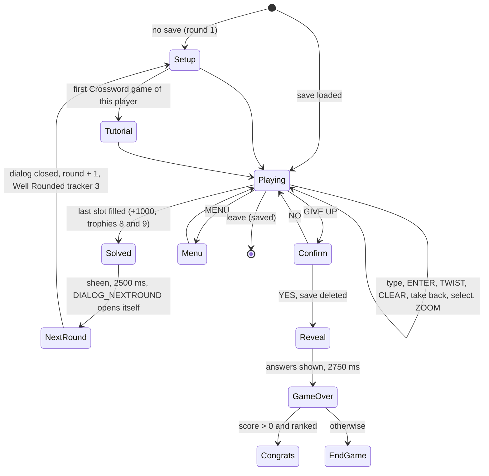

# Crossword mode (CrisscrossScene, SCENE_CRISSCROSS)

Decompiled with Ghidra 12.1.4 through REA on 2026-10-22 by Claude (plan `docs/plans/wotd-crossword.md` T4.1,
T4.2), binary `TextTwist2.exe` (sha256 `0c6e962c…a9e801`). The port's rules live in
`engine/include/tt2/round_crossword.hpp` (grid builder and a first `CrosswordRound`); the scene does not exist yet.
§10 lists what the engine still lacks.

Tags: **CONFIRMED** (read in code or shipped XML), **INFERRED** (strong reading, not proven), **UNCONFIRMED**
(searched, not found; the search trail is in §11). Constants marked "file read" were read from the exe's data
sections with `/usr/bin/python3` (the same bytes Ghidra decodes), not through an REA call. Evidence ids `CW1`..`CW43`
are listed at the end. Only keys, numbers, positions and short UI labels are copied from the install.

## 0. Corrections to the older notes (now fixed there)

- `gameplay-notes.md` §4 said guesses are checked against the full list stored at `table+0x188`. The full-list
  sub-anagrams of the root go to **`table+0x198`** (@`0x41c262..0x41c2a1`: `ADD ECX,0x2ac; CALL 0x43d7b0`, then
  `LEA EDX,[ESI+0x198]; MOV EDI,EBX; CALL 0x4336f0`); `table+0x188` holds the common list, used only for the
  "uncommon" flag (CW15). **CONFIRMED**
- `gameplay-notes.md` §4 said `srand()` was never observed and the CRT default seed 1 applies. The app seeds the
  CRT from the clock: `srand(timeGetTime())` in the application constructor (`0x46d530` @`0x46d5bd`) and
  `srand((uint)_time64(NULL))` at `0x482af0` @`0x482b04` (CW26, CW28). See §9. **CONFIRMED**
- `docs/design/wotd-crossword.md` assumed `TIME_LABEL` is shown, TWIST plays `SOUND_crossword_rotate_word`, the
  mistake flag `+0x371` means "a rejected word", the save tag is `CRISSCROSS` and grid cells are not tap targets.
  None of these holds; §3 to §8 give the real behaviour. The design doc is updated (T4.3).
- `trophies.md` tracker 3 (`0x41b000`, `mov eax,3`) was tagged INFERRED for Crossword. It is the Crossword
  next-round starter, called when `DIALOG_NEXTROUND` closes (`0x41fcf0`, CW7, CW22). **CONFIRMED**
- `trophies.md` read Perfect Puzzler's `+0x371 == 0` as "no rejected word". Its only writer is the take-back
  `0x41eaf0` (§3.6); rejected guesses never touch it. **CONFIRMED**

## 1. Scene layout (T4.1)

### 1.1 Components (`dialogs.xml` lines 135-167, CONFIRMED)

`<CrisscrossScene id="SCENE_CRISSCROSS" background="BACKGROUND" section="crosswordscene">`. All buttons except
`BUTTON_PREVWORD` have `setup="DEFAULT_BUTTON"`, `clicksound="SOUND_BUTTON"`, `soundsection="default"`; all except
`BUTTON_Menu` have `hitmaskthreshold="100"`. Images are named by id only.

| Component | Image / text (section) | Position | Notes |
| --- | --- | --- | --- |
| background | `BACKGROUND` (crosswordscene, 800×600) | (0, 0) | id clash, §1.3 |
| `OVERLAY` | `IMAGE_OVERLAY` (crosswordscene, 800×600) | no x / y | code re-adds it above the grid (`0x44b370`) |
| `UI_BAR` | `IMAGE_UI_BAR` (gamescene, 800×54) | (0, 547) | shared bottom bar |
| `SCORE_LABEL` | `TEXT_UIBAR_SCORE` "SCORE:", `FONT_UI_LABELS` | (244, 574) | anchor right |
| `LABEL_Score` | `FONT_UI_NUMBERS`, white | (251, 574) | anchor left; scene `+0x23c` |
| `LABEL_ROUND (copy)` | `TEXT_UIBAR_ROUND` "ROUND:" | (537, 574) | anchor right |
| `LABEL_ROUND` | "1", `FONT_UI_NUMBERS` | (542, 574) | anchor left; scene `+0x240` |
| `TIME_LABEL` | `TEXT_UIBAR_TIME` "TIME:" | (707, 574) | shown in XML, **hidden by code** (§4) |
| `LABEL_TimerMinutes` | "88:", `visible="false"` | (749, 574) | anchor right; `+0x234` |
| `LABEL_TimerSeconds` | "88", `visible="false"` | (752, 574) | anchor left; `+0x238` |
| `ANAGRAMS` | `AnagramTable` | (100, 75) | the code builds its own table (§2.3) |
| `BUTTON_Menu` | `BUTTON_MENU` (gamescene) | (10, 554) | tooltip `CTOOLTIP_INGAME_MENU` |
| `BUTTON_Twist` | `BUTTON_Twist` (gamescene) | (154, 447) | tooltip `CTOOLTIP_Twist` |
| `BUTTON_Clear` | `BUTTON_Clear` (gamescene) | (278, 447) | tooltip `CTOOLTIP_Clear` |
| `BUTTON_LastWord` | `BUTTON_LastWord` (gamescene) | (402, 447) | tooltip `CTOOLTIP_LastWord` |
| `BUTTON_Enter` | `BUTTON_Enter` (gamescene) | (526, 447) | tooltip `CTOOLTIP_Enter` |
| `BUTTON_NextRound` | `BUTTON_NextRound` (gamescene) | (321, 497) | **always hidden** in this scene (§3.8) |
| `BUTTON_GiveUp` | `BUTTON_GiveUp` (gamescene) | (321, 497) | tooltip `CTOOLTIP_GiveUp`; always visible |
| `BUTTON_Zoom` | `BUTTON_ZOOM` (gamescene, 4 frames 68×74) | (706, 244) | tooltip `CTOOLTIP_GiveUp` (sic) |
| `BUTTON_NEXTWORD` | `IMAGE_BTN_ARROW_NEXT` (crosswordscene) | (722, 125) | tooltip `CTOOLTIP_Clear` (sic) |
| `BUTTON_PREVWORD` | `IMAGE_BTN_ARROW_PREV` (crosswordscene) | (26, 125) | no setup, tooltip or clicksound |
| `COMMENTARY` | `COMMENTS` (gamescene) | (316, 106) | alpha 0 |
| `GAME_OVER` | `GAME_OVER` (gamescene) | (291, 264) | alpha 0 |
| `SPRITE_HIGHLIGHT` | `IMAGE_CROSSWORDHIGHLIGHT` (gamescene) | (101, 105) | hidden; unused, §3.3 |
| `PANEL_BG` | `IMAGE_PANEL_BG` (gamescene) | x 400, anchor / pivot top | hidden |
| `PANEL_BOTTOM` | `IMAGE_PANEL_BOTTOM` | (190, 120) | hidden |
| `PANEL_LEFTCORNER` / `PANEL_LEFT` | `IMAGE_PANEL_CORNERL` / `_SIDEL` | (180, 120) / (180, 0) | hidden |
| `PANEL_RIGHTCORNER` / `PANEL_RIGHT` | `IMAGE_PANEL_CORNERR` / `_SIDER` | (630, 120) / (630, 0) | hidden |

The button commands are the names with `BUTTON_` kept (`BUTTON_PrevWord`, `BUTTON_NextWord` for the arrows). The
tooltips read "Remove all letters" (`CTOOLTIP_Clear`) and "End this game" (`CTOOLTIP_GiveUp`) on the NEXT arrow and
the Zoom button; the code never sets another tooltip on them (no `CTOOLTIP` string anywhere in the exe, file
read). The selection scene's button is `BUTTON_CRISSCROSS` (528, 393, `IMAGE_BUTTON_CROSSWORD`); the high-score
dialog has `SWITCH_CROSSWORD` (39, 302) and `LABEL_CROSSWORD` (105, 320).

### 1.2 Resources (`resources.xml`, CONFIRMED; sizes from the PNG headers)

| Id (section) | File | Size / frames |
| --- | --- | --- |
| `SOUND_crossword_rotate_word` (default, line 37) | `sound/crossword_rotate_word.ogg` | volume 0.5 |
| `BACKGROUND` (crosswordscene) | `images/crosswordscene/background.png` | 800×600 |
| `LetterBox` (crosswordscene) | `images/crosswordscene/letterBox.png` | 55×54 |
| `IMAGE_LETTERBAR` (crosswordscene) | `images/crosswordscene/letterBar.png` | 367×34 (no string in the exe) |
| `IMAGE_OVERLAY` (crosswordscene) | `images/crosswordscene/overlay.png` | 800×600 |
| `IMAGE_BTN_ARROW_NEXT` / `_PREV` (crosswordscene) | `btn_arrow_next.png` / `btn_arrow_prev.png` | 52×336, 4 frames of 52×84 |
| `IMAGE_CROSSWORDHIGHLIGHT` (gamescene) | `images/gamescene/crosswordHighlight.png` | 572×1080, 12 frames of 572×90 |
| `XwordBox` (gamescene) | `images/gamescene/XwordBox.png` | 69×138 (2 frames of 69×69, INFERRED) |
| `IMAGE_XWORD_OVERLAY` (gamescene) | `letterBox_cwordhole.png` | 69×69 |
| `IMAGE_XBOX` (gamescene) | `letterBox_cword.png` | 35×35 |
| `BUTTON_ZOOM` (gamescene) | `button_zoom.png` | 68×296, 4 frames |

`default.xml` has `CROSSWORD_AVAILABLE_Y = 400` and `CROSSWORD_WORD_NUMBER_INCREMENT = 0.2`; neither string is in
the exe (file read), so both are unused. The word count uses `BLITZ_WORD_NUMBER_INCREMENT` (0.2, §3.2).

### 1.3 Id clashes

- `BACKGROUND` exists in `gamescene` (`images/gamescene/background.png`) and in `crosswordscene`. The scene's
  `background` attribute resolves in its own `section="crosswordscene"`, so Crossword draws the crosswordscene file.
  **CONFIRMED (XML)**; the port needs section-qualified ids (`crosswordscene/BACKGROUND`).
- `LetterBox` exists in `gamescene` (`letterBox.png`, 2 separate frames) and in `crosswordscene` (55×54). Which one
  the rack draws is **UNCONFIRMED**: the LetterBox constructor `0x43ab90` was not traced; it references
  `XwordBox` (xref `0x43aeea`, CW32), whose 69 px frames match the rack spacing (§3.4).

## 2. Objects and state

### 2.1 Scene fields (CONFIRMED unless tagged)

Vtable `0x5902fc` (file read): slot 0 dtor `0x419bb0`, 24 buttons `0x41b910`, 25 update `0x41ebc0`, 44 enter
`0x41ef40`, 45 exit `0x41f0c0` → `0x41a170`, 51 init `0x419d40`, 53 mouse down `0x421e50`, 54 NEXTROUND closed
`0x41fcf0`, 55 leave `0x41f7d0`, 56 unlock `0x41f7b0`, 57 `0x41ba30` = `0x41ba40(1)`. A second interface at
`scene+0x174` carries the keyboard handler `0x41f120` (pointer at `0x5904c0`) and the pointer handler `0x41f2b0`.

| Offset | Meaning |
| --- | --- |
| `+0x20c` | pending dialog, run by the update: 1 / 2 menu, 3 next round, 4 give-up confirm, 5 tutorial |
| `+0x260` | dialog lock (all buttons disabled) |
| `+0x264` | round state: 0 playing, 1 solved, 2 given up |
| `+0x2f9` | busy (animation running; input ignored, buttons disabled) |
| `+0x2fc` | timer field, set to 0 every round and never counted (§4) |
| `+0x300` / `+0x308` | round / score |
| `+0x370` | twisted this round (Puzzle Pro blocker) |
| `+0x371` | took a solved word back this round (Perfect Puzzler blocker) |
| `+0x378` | selected word object |
| `+0x380..+0x384` | word objects, index = placement index, root first |
| `+0x39c` / `+0x3a0` | `BUTTON_NEXTWORD` / `BUTTON_PREVWORD` |
| `+0x3a4` | grid view (0x17c-byte node from `0x434da0`); its scale `+0x6c` is 1.0 or 0.5 |
| `+0x3a8` | highlight sprite, built in code (§3.3) |
| `+0x3c0` | CrosswordTable (0x8b0 bytes, ctor `0x435760`) |
| `+0x3c8` | direction the grid view is turned to (1 = horizontal) |
| `+0x3c9` | zoom flag; `+0x3cc` is `BUTTON_Zoom` |
| `+0x34c` / `+0x350` | popup anchor (400.0, **70.0**); the Classic scene uses (400, 150) |

### 2.2 Word object (0xbc bytes, ctor `0x434f40(parent, rack, len, index, restore)`, CW36)

| Offset | Meaning |
| --- | --- |
| `+0x04` | index into the placements |
| `+0x18` | rack letters: the **root** string, for every word (save key `SOURCE`) |
| `+0x3c` / `+0x50` | played word / its length; non-zero length = solved (save key `PLAYED`) |
| `+0x60` / `+0x74` | last word typed for this slot / its length (LAST WORD) |
| `+0x84` | solved |
| `+0x85` | scored (save key `SCORED`); never cleared by taking the word back |
| `+0x88` | slot length (save key `LENGTH`) |
| `+0x90` | the builder's answer (save key `HINT`) |
| `+0xb4` | rack: one letter ball per root letter, at x = 400 − n·69/2, y = 375; shown only while unsolved |
| `+0xb8` | entry row: `len` cells, moved into the grid view; cell `+0x180` = locked letter |

### 2.3 Table (`+0x3c0`)

`+0x188` common sub-anagrams of the root (INFERRED: the shuffled list the word set was drawn from), `+0x198` full-list
sub-anagrams of the root, `+0x1b4` slot objects (`+0x1b0` = filled), `+0x8a4` placements (8-byte entries; placement
`+0x2c` = horizontal, `+0x38` = crossing list). The XML `ANAGRAMS` component is a generic `AnagramTable`; whether it
is drawn at all is UNCONFIRMED (§11).

## 3. Round flow

### 3.1 Game start (CONFIRMED, CW6, CW7)

- Enter `0x41ef40`: music `MUSIC_in-game_1` (section `music`) at volume 0.7 (`0x3f333333`), then `0x41a110`.
- `0x41a110`: save tag **`CROSSWORD`** (`0x590254`). A save exists → load `0x420fa0`; else round setup
  `0x41ba40(1)`. The string `CRISSCROSS` (`0x5917fa`) has no xrefs (CW31).
- Init `0x419d40` (CW5): `+0x2f0 = 6`, `+0x2f4 = 8`; grid view and highlight sprite created; `setVisible(0)` on
  `+0x234`, `+0x238` **and `+0x244` (`TIME_LABEL`)**; popup anchor (400, 70).

### 3.2 Round setup `0x41ba40(round)` (CONFIRMED, CW14, CW15)

1. Unlock, free the old word objects, clear the popup queue, `+0x264 = 0`.
1. Tutorial: player byte `0xc0 + mode` (mode `0x5fdea8` = 3 in Crossword) is tested and set; when it was 0,
   `+0x20c = 5` opens `DIALOG_TUTORIAL` ("Crossword Mode") on the next update. Once per player.
1. `+0x2fc = 0`, `+0x300 = round`, `+0x370 = 0`, `+0x371 = 0`; round 1 zeroes the score. Labels updated.
1. Root and word set exactly as `gameplay-notes.md` §4: `L = min(5 + rand%4, maxLen)` (LCG), the `0x43d550` pick,
   common sub-anagrams shuffled with the CRT, exactly one full-length entry, `N` from
   `BLITZ_WORD_NUMBER_INCREMENT`, root appended last.
1. Full-list sub-anagrams of the root → `table+0x198`; the common list → `table+0x188` (§0); grid built
   (`0x436090`). A failed build restarts the setup.
1. One word object per placement, root first. Every rack holds the whole root, shuffled on its own (`0x43c370`,
   CRT). The root is selected first; `+0x3c8 = 1`; grid rotation 0.

No round-start sound was found in `0x41ba40` (§11).

### 3.3 Selecting a word (CONFIRMED unless tagged, CW16, CW17, CW20, CW38)

- **NEXT** arrow, Tab and key `0x16` (INFERRED: Right) → `0x41e140(0)`: index + 1, wrapping, **solved words
  included**. **PREV** arrow and key `0x14` (INFERRED: Left) → `0x41e230`: index − 1, wrapping. Both select only
  if the index changes (one word: nothing happens). No pass, no counter, no sound in code; the NEXT arrow's
  `SOUND_BUTTON` comes from its XML, the PREV arrow plays nothing.
- **Clicking a word's row** in the grid (mouse `0x421e50`, only inside x 85..715, y 20..360, not while busy) selects
  that word; a click on the selected word goes to the pointer handler (§3.4). After the round, a click looks the
  word up instead (§3.9).
- Select `0x41e7f0`: clears the typed letters of an unsolved selected word, hides its rack, switches, shows the new
  rack if that word is unsolved, refreshes the buttons, then:
  - **Rotate** `0x41d390`: when the new word's direction differs from `+0x3c8`, plays
    **`SOUND_crossword_rotate_word`** (its only xref, `0x41d42e`, CW18) and turns the whole grid view by ±π/2, with
    every letter turned back, so **the selected word always reads left to right** on screen. When zoomed out by the
    player (`+0x3c9 == 1`) it scales back to 1.0.
  - **Pan** `0x41d160`: `ModifierLocationLine`, smoothstep (`0x4513d0`), to (400 − x, 189 − y) of the word;
    500 ms (INFERRED: `mov r,500` @`0x41d304` next to the modifier call, file read).
  - Then `0x41cd00`: the selected row's crossing cells take the letters of the **solved** crossing words and are
    locked (`+0x180 = 1`); the others are unlocked; the highlight is placed.
- **Highlight** (`0x41de10` / `0x41df10`): the sprite `+0x3a8` (`IMAGE_CROSSWORDHIGHLIGHT`, 12 frames of 572×90) is
  created in code, child of the grid; the XML `SPRITE_HIGHLIGHT` name is not in the exe (file read). Position = entry
  row (x − 10, y − 11); rotation 0 for a horizontal word, π/2 for a vertical one; **frame = len − 3**. When the word
  is unsolved and `0x41e060` reports a dead end, frame = **len + 3** and popup **9** shows (INFERRED: no unplayed
  valid word fits the locked letters any more). Frame width 572 = 8 × 69 + 20, so one cell is 69 px at scale 1.0.
- After a solve, `ModifierDelay` 700 ms then `0x41e140(1)`: the next **unsolved** word, wrapping (§3.5).

### 3.4 Typing (CONFIRMED unless tagged, CW37, CW38)

- Keyboard letters → `0x41aa20(letter)`; clicking a rack letter → `0x41f2b0` (same checks). With room in the row:
  `SOUND_letter_place` and the ball moves to the next free cell; locked cells keep their letter.
- **Popup 7**: when the next cell is locked (`0x43c060`) and a string compare (`0x40b230`) fails, nothing is placed
  and popup 7 shows. INFERRED: the typed letter differs from the locked crossing letter.
- **Popup 4** ("crossword intersection"): after a letter lands on a crossing whose other word is unsolved,
  `0x41e270` collects that word's fixed letters (the new one plus letters from solved words that cross it) and
  removes each from a copy of the root; when a letter is missing, popup 4 shows and the letter is taken back
  (`0x41b390(0)`). INFERRED reading: the crossing word would need more copies of a letter than the root has.
- Clicking the last typed letter of the row takes it back (`0x41f2b0` → `0x41b390`).

### 3.5 ENTER `0x41a510` (CONFIRMED, CW9, CW10, CW11, CW12, CW13)

1. The row text is copied to `+0x60` (LAST WORD). If its length differs from the slot length (`+0x88`), **return**:
   no sound, no popup (@`0x41a5c7`).
1. `0x436a00(typed, index)`:
   - not in `table+0x198` (full-list sub-anagrams of the root) → **0**: `SOUND_word_reject`, row cleared, popup
     **0**;
   - equal to the word already placed in any filled slot → **−1**: `SOUND_word_reject`, row cleared, popup **3**;
   - else uncommon = not in `table+0x188`; the typed word is written into **this** slot (`0x436ff0`) → **1**.
1. Accepted: Word Nerd counter (`0x40f1e0`), Human Dictionary counter when uncommon (`0x40f3a0`). If `+0x85 == 0`:
   score `+= 10·len²` (@`0x41a665`), `+0x85 = 1`. Length = root length → `+0x84 = 1`, `SOUND_word_bingo`; else
   `SOUND_word_correct`. Then solved `0x41e930` (§5.1); all words solved → `+1000` (@`0x41a7e0`). Score label set.

So **the guess goes into the selected slot only**, and **any** full-list word of that length made from the root's
letters fills it, as long as it agrees with the locked letters and is not already in the grid. The slot then shows
the player's word, which can differ from the builder's answer (`+0x90`); crossing slots inherit its letters. No
rejection writes `+0x371`, and no accepted word shows a popup.

### 3.6 Other inputs (CONFIRMED unless tagged)

| Input | Handler | Effect |
| --- | --- | --- |
| TWIST, Space (`0x11`) | `0x41b060` (CW16) | shuffle the selected word's rack (`0x43c370`), **`SOUND_word_twist`**, `+0x370 = 1`, twist counter (`0x40f170`) |
| CLEAR, Delete (4) | `0x41a3d0` (CW11) | `SOUND_letter_clear`, every typed letter back to the rack (`0x41b390` per cell) |
| Backspace (1) | `0x41b390` (CW34) | `SOUND_letter_clear`; unsolved: last letter back; **solved: take the word back** (`0x41eaf0`) |
| LAST WORD | `0x41ae20` (CW33) | `SOUND_word_last`; fills the unlocked cells with `+0x60` when it fits the row |
| Return (5) | `0x41f120` | unsolved word only: row has letters → ENTER, else LAST WORD |
| ZOOM, keys `0x15` / `0x17` | `0x41b1c0` (CW16) | §3.7 |
| NEXT / PREV, Tab, `0x16` / `0x14` | `0x41e140` / `0x41e230` | §3.3 |
| MENU | `0x41b910` | `+0x20c = 1` → `DIALOG_MENU` |
| GIVE UP | `0x41b910` | `+0x20c = 4` → confirm (§5.3) |

Keyboard `0x41f120` (file read: jump tables `0x41f274` / `0x41f294`): ignored while busy (`+0x2f9`) or after the
round (`+0x264 != 0`); codes 1..0x17 as above, every other code types a letter. INFERRED: `0x14..0x17` are the
arrow keys (as in `lightning.md` §2.4), so Left / Right move the selection and Up / Down zoom.

**Taking a solved word back** `0x41eaf0` (CW35): only when the selected word is solved: played word cleared,
`+0x84 = 0`, tiles flip back (`0x43c890(0)`), row cleared, the table slot emptied (`0x4370c0`), the rack shown
again, **`+0x371 = 1`**. `+0x85` stays set, so solving that slot again adds no points. It is reached through
`0x41b390` @`0x41b498`: Backspace, a click on the row's last letter, or CLEAR (INFERRED for CLEAR: its button is
enabled whenever the row has letters, a solved row included). `+0x371` has no other writer in the scene code
(byte scan of `0x419000..0x423000`: `0x41bbd4` reset, `0x41e9bf` read, `0x41eb9a` set; file read).

### 3.7 Zoom (CONFIRMED unless tagged, CW16)

- Scale 1.0 → `+0x3c9 = 0`, busy, `ModifierScale` to **0.5** (1000 ms, INFERRED from `mov r,1000` @`0x41b27d`, file
  read), list look switch `0x41b320(false)` on every word.
- Scale 0.5 → `+0x3c9 = 1`, `0x41d160`: back to the selected word (pan, and scale 1.0 in `0x41d390`; a
  `mov r,1500` @`0x41d7b9` sits next to that modifier, INFERRED duration).
- At 1.0 the 18-cell grid is 18 × 69 = 1242 px wide, so only part of it is on screen; at 0.5 it is 621 px, inside
  the 630 px click area. INFERRED: that is why the view pans to each selected word.

### 3.8 Button refresh `0x41b510` (CONFIRMED, CW23)

- Lock (`+0x260`) or busy (`+0x2f9`): all ten buttons disabled, visibility unchanged.
- All solved: Menu on; Twist, Enter, LastWord, Clear, Zoom, Next, Prev off; NextRound hidden and off; GiveUp off
  but visible.
- Playing: Menu on; Twist on iff rack length > 1 and the word is unsolved; Enter on iff unsolved and the row has
  letters; LastWord on iff the row is empty and `+0x60` is not; Clear on iff the row has letters; Next, Prev, Zoom
  on; **NextRound hidden and disabled; GiveUp visible and enabled**. The NEXT ROUND button never shows in Crossword.
- Button dispatcher `0x41b910` (CW8): Menu, NextRound, GiveUp work in any state; every other button only while
  `+0x264 == 0`. There is no hint and no pass.

### 3.9 Definition links (checked on 2026-10-22 for OI-13; CONFIRMED unless tagged)

- The click handler `0x421e50` (CW42) returns at once while busy (`+0x2f9`), and only looks at clicks inside
  x 85..715, y 20..360 on a word's row (`word+0xb8`). Then it switches on the round state `+0x264`:
  - **0, playing:** the selected word's row → letter handler; another row → select it (§3.3). **No lookup.**
  - **1, solved:** `0x419020(word+0x3c)`, the **played** word, then `0x4409f0`.
  - **2, given up:** `0x419020(word+0x90)`, the builder's **answer** (every row, solved or not), then `0x4409f0`.
- `0x419020` builds `http://dictionary.reference.com/browse/` (`0x58feec`) + the word; `0x4409f0` is
  `ShellExecuteA(GetDesktopWindow(), "open", url, …, SW_SHOW)` (CW42). The URL string has four xrefs: three in
  `0x419020` and one in Classic's `0x433500` (CW39). `0x433500` is called only from the Classic scene
  (`0x427680`, `0x427a60`, CW40); `0x419020` only from Blitz (`0x417f50`) and Crossword (`0x421e50`, CW41). So
  Crossword has its own path, shaped like Blitz's, and never reaches `0x433500`.
- **Popup 10** ("click entered words for their definition") **never shows in Crossword**: the scene's popup call
  sites (`0x41a510`, `0x41aa20`, `0x41df10`, `0x41f2b0`, CW43) push only kinds 0, 3, 4, 7 and 9 (file read).
- **Reachability, UNCONFIRMED (INFERRED: never in practice).** State 1 begins with the 2500 ms sheen and state 2
  with the 2750 ms answer reveal, both busy, so clicks are ignored. Each ends by opening a dialog:
  `DIALOG_NEXTROUND` (state 1) or `DIALOG_CONGRATS` / `DIALOG_ENDGAME` (state 2). All three have
  `dodarkenbackground="true"` (`dialogs.xml` lines 324, 340, 354). Closing `DIALOG_NEXTROUND` starts the next round
  at once (state 0), and the game-over dialogs leave the scene. So a lookup can only fire if a click on the grid
  passes **through** the darkened, open dialog, and the dialog code was not traced. The user can check it on the
  original: solve a puzzle or give up, then click a grid word beside the dialog.

## 4. Timer: none (CONFIRMED)

The update `0x41ebc0` (CW1, CW2) only runs the pending-dialog switch, the button refresh, the trophy queue and the
popup queue; its `dt` is unused. Round setup sets `+0x2fc = 0` and nothing counts it. Init hides `TIME_LABEL` and
both timer labels, so the UI bar shows SCORE and ROUND only. There is no time-out, no lives, and no clock sound.

## 5. Round end and game over

### 5.1 Puzzle solved `0x41e930` (CONFIRMED, CW11, CW20, CW22)

1. `0x4355d0(1)` on the selected word: played word = row text, `+0x84 = 1`, tiles flip.
1. Not all solved: `ModifierDelay` 700 ms, then select the next unsolved word (§3.3).
1. All solved: `+0x264 = 1`, select (`0x41e7f0`); Puzzle Pro (id 8) when `+0x370 == 0` and not yet won; Perfect
   Puzzler (id 9) when `+0x371 == 0` and not yet won (§6).
1. ENTER adds the `+1000` after this call. The select ends in `0x41cd00`, which for `+0x264 != 0` runs the reveal
   `0x41fed0` (callers: `0x41cd00` only, CW21): busy, zoom out to 0.5, `SOUND_letter_sheen` (only xref `0x420047`,
   CW19) and a sheen over every row, `ModifierDelay` **2500 ms**, then `0x428a60`: `+0x2f9 = 0`, `+0x20c = 3`.
1. The next update plays `SOUND_game_next_round_acheived` and opens **`DIALOG_NEXTROUND` on its own**.

### 5.2 Next round (CONFIRMED, CW7, CW22)

Closing `DIALOG_NEXTROUND` (`0x41fcf0`): unlock, refresh, `0x41b000`: Well Rounded tracker 3 (`0x40f2b0`), then
`0x41ba40(round + 1)`. The score carries over. The game never ends on its own.

### 5.3 GIVE UP = game over (CONFIRMED, CW1, CW22, CW33)

- `+0x20c = 4` → confirm dialog (`TEXT_DIALOG_GIVEUP_HEADER` / `TEXT_DIALOG_GIVEUP`, `0x40b310`).
- NO (`0x41fc30`): close, unlock, refresh.
- YES (`0x41fb50`): close, `+0x264 = 2`, **delete the save** (`0x461840`), select → `0x41cd00` → reveal: every row
  shows its answer (`0x43ce60`), `ModifierDelay` **2750 ms**, then `0x41f7f0` → `0x41f800`.
- Game over `0x41f800`: `+0x2f9 = 0`; table **`crossword`** (`0x5919d0`, CW30). Score > 0 → an entry with mode 3
  and an `extra` text from `0x449c90` (int → string; INFERRED: the round, as Blitz) is inserted (`0x457cd0`); a rank
  plays `SOUND_game_high_score_achieved` and opens `DIALOG_CONGRATS`, else `DIALOG_ENDGAME`. Score 0 → INFERRED
  `DIALOG_ENDGAME` without an entry.

### 5.4 Menu, leave, exit (CONFIRMED, CW6, CW7)

- `+0x20c` 1 / 2 → `DIALOG_MENU`; 5 → `DIALOG_TUTORIAL`.
- Leave `0x41f7d0`: save (`0x4203f0`) only while `+0x264 == 0`, then the shared leave `0x427b40`.
- Exit `0x41a170`: closes `CTEXT_MENU_STOP`, `DIALOG_MENU`, `DIALOG_HIGHSCORES`, `DIALOG_CONGRATS`, `DIALOG_ENDGAME`
  and clears the popup and trophy queues.

### 5.5 Save and load (CONFIRMED string pushes, file read; recorded only, D-10)

Save `0x4203f0` (CW33), under the player, tag `CROSSWORD`: `DATA` / `GAME` { `ROUND` (`+0x300`), `TIME` (`+0x2fc`,
always 0), `SCORE` (`+0x308`), `WORD` (the root, word 0's `+0x18`), the table (`0x437140`, key
`CROSSWORD_TABLE`), `CROSS_LIST` of `CROSS_INFO` { `SOURCE`, `HINT`, `PLAYED`, `LENGTH`, `SCORED` } }. Load
`0x420fa0` reads the same keys in that order and writes `+0x300`, `+0x2fc`, `+0x308`. INFERRED (load not
decompiled): the grid comes back from `CROSSWORD_TABLE` and is never rebuilt, and a non-empty `PLAYED` restores a
solved word (the word-object constructor sets `+0x84` when its restore string is not empty, CW36).

## 6. Trophies and counters (CONFIRMED, CW11, CW35)

| Trophy | Rule in Crossword |
| --- | --- |
| 8 Puzzle Pro ("Solve a Crossword with no twisting.") | puzzle solved with `+0x370 == 0`: no TWIST this round |
| 9 Perfect Puzzler ("… with no mistakes.") | puzzle solved with `+0x371 == 0`: **no solved word taken back** |
| Well Rounded, tracker 3 | `0x41b000`, when `DIALOG_NEXTROUND` closes |
| Word Nerd / Human Dictionary counters | every accepted word / every uncommon accepted word |
| twist counter (With a Twist …) | every TWIST |

A rejected guess (popup 0 or 3) blocks neither trophy.

## 7. Scoring (CONFIRMED)

- `10 × len²` the first time a slot is solved (`+0x85`); a bingo (all root letters) scores the same, with its own
  sound and no popup.
- `+1000` when the last slot is solved.
- The score runs across rounds until GIVE UP; it goes to the `crossword` high-score table at game over.

## 8. Sounds, popups, music

| Event | Sound / popup |
| --- | --- |
| letter placed / taken back / cleared | `SOUND_letter_place` / `SOUND_letter_clear` |
| guess not a word / already in the grid | `SOUND_word_reject` + popup 0 / popup 3 |
| word / bingo accepted | `SOUND_word_correct` / `SOUND_word_bingo` |
| TWIST | `SOUND_word_twist` |
| LAST WORD | `SOUND_word_last` |
| grid turns for a word of the other direction | `SOUND_crossword_rotate_word` |
| puzzle solved | `SOUND_letter_sheen`, then `SOUND_game_next_round_acheived` with `DIALOG_NEXTROUND` |
| high score at game over | `SOUND_game_high_score_achieved` |
| letter breaks a crossing / clashes with a locked letter | popup 4 / popup 7 (INFERRED meanings) |
| selected word has no fitting word left | popup 9 and the red highlight frame (INFERRED meaning) |
| definitions hint | never: popup 10 has no Crossword call site (§3.9) |
| music | `MUSIC_in-game_1`, volume 0.7 |

Popups use the shared queue (`game-scene.md` §5.1), anchored at (400, 70).

## 9. CRT seed (OI-3, CONFIRMED)

- `srand` is `0x4c5700` (`call _getptd; mov [eax+0x14], seed`, file read); `rand` is `0x4c570d`
  (`holdrand·0x343fd + 0x269ec3`, `>> 16 & 0x7fff`). Five callers of `srand` (CW26): `0x46d5bd` in the
  `GF2::Application` constructor `0x46d530`, `srand(timeGetTime())`, at start-up; `0x482b04` in `0x482af0`,
  `srand((uint)_time64(NULL))`; `0x4f5829` (`0x4f57f0`, a multipart-boundary helper, time + counter) and `0x50fb99`
  (`0x50fb90`, `srand(clock())`), both library code; `0x4b523c` in undefined code (CW28, CW29).
- Every seed is clock-based, so **the original never uses the CRT default seed 1** and its own grids, rack shuffles
  and twists differ from run to run. Which seed is live when a round starts is UNCONFIRMED, and it does not matter:
  no fixed seed reproduces the original's grids. The `rand` state is process-wide, so a second game in the same run
  continues the sequence.

## 10. The port: rule gaps for T5.1 and deviations

`round_crossword.hpp` builds the same grid and word set. Its `CrosswordRound::guess` matches the text against any
unfilled grid word and has a `NoRoom` result; the original has neither. T5.1 must add:

| Gap | Original rule | Where |
| --- | --- | --- |
| G1 selection | a selected slot; NEXT / PREV wrap over all words; after a solve, the next unsolved (wrapping) | §3.3 |
| G2 slot-bound guess | length ≠ slot → ignored; not in the full-list sub-anagrams of the root → not a word; equal to a word already in the grid → duplicate; else fills the selected slot with the typed word | §3.5 |
| G3 played vs answer | a slot holds the player's word, which can differ from the answer; GIVE UP reveals the answers | §3.5, §5.3 |
| G4 crossings | every crossing of a word (not only the builder's `crossing` index); locked letters from solved crossing slots | §3.3 |
| G5 typing checks | crossing letter-count check (popup 4); locked-letter clash (popup 7); dead-end check (popup 9) | §3.3, §3.4 |
| G6 take back | un-solve a slot: played word cleared, scored flag kept, mistake flag set | §3.6 |
| G7 score | `10·len²` once per slot (scored flag), `+1000` at the end, running total across rounds, round number | §7 |
| G8 flags | twisted and mistake flags, reset each round | §3.2, §6 |
| G9 restore | root, round, score, placements and per-slot played word and scored flag; the grid is never rebuilt | §5.5 |
| G10 uncommon | accepted word not in the common sub-anagrams of the root | §3.5 |

Decisions and deviations (user, T4.4, 2026-10-22):

- **D2** accepted: grids differ from the original's for the same root. The original is clock-seeded (§9), so it
  cannot be matched even in principle; the rules are the same. The port keeps one process-wide `CrtRandom`, seeded
  from the clock once (D-11, OI-3).
- Other valid words fill the slot, as in the exe (OI-12). Full animations (grid turn, pan, zoom) as in the exe.
- The port's save tag is `CROSSWORD`, as in the exe (OI-11); keys and file layout stay the port's own text format
  (D-10).
- Definition links (§3.9, OI-13): the scene reuses `Services::open_url` + `definition_url()` with the same
  `https://www.dictionary.com/browse/` deviation as Classic (`game-scene.md` §4), in states 1 and 2 only, played
  word / answer, no popup 10. The port's dialogs are modal, which matches the INFERRED reading above; if the user
  finds the original's clicks pass through its dialogs, that is a T7.1 gap.
- INFERRED readings (popups 4, 7, 9; 1000 / 500 / 1500 ms; Up / Down = zoom) are working assumptions until T7.1.

## 11. Search trails for UNCONFIRMED items

| Item | Searched | Result |
| --- | --- | --- |
| Round-start sound | `0x41ba40` (CW14, CW15); every string push in `0x419000..0x423000` (file read): no load or start sound among the 11 `SOUND_` ids | none in the scene code; shared code not searched |
| `ANAGRAMS` drawn? | the string `ANAGRAMS` is not in the exe (file read); init looks up `OVERLAY`, `BUTTON_Zoom`, the arrows | never looked up by name |
| `COMMENTARY`, `GAME_OVER`, `PANEL_*` | `COMMENTARY` and `GAME_OVER` are not in the exe; `PANEL_BG` once, outside the scene range (file read) | not used by this scene's code |
| Which `LetterBox` the rack uses | `XwordBox` xref `0x43aeea` (CW32) inside `0x43ab90`; ctor not decompiled | open |
| Popup 4 / 7 / 9 meanings | `0x41e270`, `0x41aa20`, `0x41df10` pseudo (CW37, CW38); `0x41e060`, `0x43c060`, `0x40b230` not decompiled | INFERRED readings in §3.3-§3.4 |
| Zoom, pan, rotate durations | register immediates next to the modifier calls (file read) | INFERRED 1000 / 500 / 1500 ms |
| High-score `extra` | `0x41f800` (CW33): `0x449c90` int → string before the insert | INFERRED round |
| Load details | string pushes and field stores in `0x420fa0` (file read) | keys CONFIRMED, flow INFERRED |
| Live CRT seed at round start | five `srand` callers (CW26) | all clock-based; order not traced |
| Key codes `0x14..0x17` | code → char table `0x5d3228` has no char for them (`lightning.md`) | INFERRED arrow keys |
| Definition click under the end dialogs | `0x421e50` (CW42); dialog attributes in `dialogs.xml`; the dialog input path was not traced (a vtable-`0xd4` call at `0x462e60` turned out to be a scene switch) | INFERRED unreachable, §3.9 |

## 12. State diagram

## 13. Address index

| Address | What |
| --- | --- |
| `0x5902fc` | CrisscrossScene vtable |
| `0x419d40` / `0x41ef40` / `0x41a110` | init / enter (music) / start or resume |
| `0x41ebc0` | update: pending dialogs, refresh, trophy and popup queues; no timer |
| `0x41b910` / `0x41f120` / `0x41f2b0` / `0x421e50` | buttons / keyboard / rack and row clicks / mouse down |
| `0x41ba40` / `0x41ba30` | round setup / new game (`0x41ba40(1)`) |
| `0x434f40` / `0x4355d0` | word object / set solved |
| `0x436a00` / `0x436ff0` | guess check / write into the slot |
| `0x41a510` / `0x41aa20` / `0x41b390` | ENTER / type a letter / take back a letter |
| `0x41a3d0` / `0x41ae20` / `0x41b060` / `0x41b1c0` | CLEAR / LAST WORD / TWIST / ZOOM |
| `0x41eaf0` | take a solved word back (`+0x371 = 1`) |
| `0x41e140` / `0x41e230` / `0x41e7f0` | next / previous / select word |
| `0x41d390` / `0x41d160` / `0x41cd00` | rotate the grid / pan / lock crossing letters |
| `0x41de10` / `0x41df10` / `0x41e060` | highlight / highlight + dead-end check (popup 9) / dead-end test |
| `0x41e270` | crossing letter-count check (popup 4) |
| `0x41b510` / `0x41b8c0` | button refresh / all solved? |
| `0x41e930` | slot solved: auto-advance or puzzle solved, trophies 8 and 9 |
| `0x41fed0` / `0x428a60` | reveal (sheen 2500 ms or answers 2750 ms) / open the next-round dialog |
| `0x41fcf0` / `0x41b000` | NEXTROUND closed / tracker 3 and next round |
| `0x41fb50` / `0x41fc30` | GIVE UP yes / no |
| `0x41f7f0` / `0x41f800` | game over (high score `crossword`) |
| `0x41f7d0` / `0x4203f0` / `0x420fa0` | leave / save / load |
| `0x41a170` | exit: close dialogs, clear queues |
| `0x419020` / `0x4409f0` | dictionary URL + word / `ShellExecuteA("open")` (shared with Blitz) |
| `0x433500` | Classic's found-word lookup (not used by Crossword) |
| `0x4c5700` / `0x4c570d` | CRT `srand` / `rand` |
| `0x46d530` / `0x482af0` | `srand(timeGetTime())` / `srand(_time64)` |

## Evidence ids

| Id | Call | evidence_id |
| --- | --- | --- |
| CW1 | pseudo `0x41ebc0` | `ev_ba0207c5674941ec58ac6e7579bdb41836a87bca2c9328cf6ecd7a9091262b98` |
| CW2 | asm `0x41ebc0` | `ev_583e7285372cefd0e1a6c98cf7220a748d6b8b00d0d67abbc6e9840ce150b9a3` |
| CW3 | bytes `0x591880` (update strings) | `ev_c611e21919f3155db475523aae4799e4c201de1163ffe73332b44ef30257343f` |
| CW4 | xrefs `0x41ebc0` | `ev_f73a09bdb53bb676b888aabe2a7346ba5f411c90f863ef7942697fdb849170dc` |
| CW5 | pseudo `0x419d40` | `ev_3a16e6eec203c041442247c8d12d1ddd52bf4cefc78c41929d31eef77fd15ebb` |
| CW6 | batch `0x41ef40 0x41f0c0 0x41ba30 0x41f7b0 0x41f7d0` | `ev_0dee34180bf89acbabdfb10702f024dc6a2ede5a3806ae7623e58e5e6cdb063f` |
| CW7 | batch `0x41a110 0x41a170 0x41b910 0x41b510 0x41fcf0` | `ev_1c950995257a18451f2c4c2d87d4a4b37885d70f8d67c7f088a1f44525e63728` |
| CW8 | asm `0x41b910` | `ev_075969ab33a33af50f31e623ff52a0c403d62be2509d3e44c9359762dc277ace` |
| CW9 | pseudo `0x41a510` | `ev_93096836b0716e583f8bb96dc520b382c8da5bc9faca2327498afe24bbb3249b` |
| CW10 | asm `0x41a510` | `ev_ecb20f8921645aedbbade40e7b6a69ea1962468a3901fbe5a32be66407923623` |
| CW11 | batch `0x436a00 0x41b8c0 0x41e930 0x41a3d0` | `ev_f466291c00d3e1386a4db6270e8a0bcb4756e8c844e01ba0141e44c0c7e5c302` |
| CW12 | asm `0x436a00` | `ev_bc929ddc2208fb18e19230b48b7afe8fa2ba229982c102d00ad9e7003b12b621` |
| CW13 | pseudo `0x436ff0` | `ev_e2714d88cb1cb009d0ed37e69581d9be949e6f2ce93a567496a44689c50b3b0b` |
| CW14 | pseudo `0x41ba40` | `ev_3d01cf85e5b820ff5038326925685526ef5895fb1a7e928ee1cf58b0d91a76e5` |
| CW15 | asm `0x41ba40` | `ev_74d4e3c65879766a3640cd2299368066a32c67a702a0bd57a1671fc2a9e89e68` |
| CW16 | batch `0x4336f0 0x41b060 0x41b1c0 0x41e140 0x41e230` | `ev_c4cc53a9b69e2baad2095d91403707366cd556251616bdb0097d731a047e8133` |
| CW17 | batch `0x434f40 0x41e7f0 0x41d160 0x41b320` | `ev_017baa71a061652dc53428602ae62aff6c6e9f66b0ef7bf33394bab5ff6fc3c0` |
| CW18 | xrefs `SOUND_crossword_rotate_word` | `ev_26ee1450c8ab5bc1a7fc756b4004fc09d7c8cacd4c3c12f61a7ca4d5af67d78e` |
| CW19 | xrefs `SOUND_letter_sheen` | `ev_55cb88c2cdd9603b9b9bd78bd4b2bd43052c83bbb16627136f2a7ada7935340d` |
| CW20 | batch `0x41d390 0x41fed0 0x41de10 0x4355d0` | `ev_266b567ceb5a369b7cd94e171af94c1e372833bb404d71a6c7da3562c0353634` |
| CW21 | callers `0x41fed0` | `ev_13c9d1888841798a64cf6e43b5d14f7b71778af53d3c9c5f5c2dc5c30339e665` |
| CW22 | batch `0x41f7f0 0x41fb50 0x41fc30 0x41b000 0x41cd00` | `ev_855f626ba16600f1c972cb8ef75e10354fb8b3e39c3022b8ec5701d9fd130f7a` |
| CW23 | asm `0x41b510` | `ev_ec4cb4df5fcc3e41da6474c81e87524aae94bcb633dd5b71922b644c931bd703` |
| CW24 | search procedures "rand" | `ev_f62c5840be6b2cf6c5a83bb727f37967f5d9423257dd5a6b534a1b3c9e90e7eb` |
| CW25 | containing procedure `0x41f7f0` | `ev_be53fbbbc8a55310e864f1fc768de2e2c53489bfdb20ab727f13ecb0dce7de92` |
| CW26 | xrefs `srand` `0x4c5700` | `ev_7fb00401b511f2ba73f657b9d7d5283b4d7bd83b61f2dcddac5f813d18a42796` |
| CW27 | xrefs `rand` `0x4c570d` | `ev_8b21c98ffb3322675dc754babf0782cabbff24e422298c34c5c227c3fde334ae` |
| CW28 | batch `0x46d5bd 0x482b04` | `ev_7af643b5565c86e2335d46762fa92bc68f825c33d3f9463f12b2f76a2e68e4ef` |
| CW29 | batch `0x4b523c 0x4f5829 0x50fb99` | `ev_254df08f236fcdf8ca5ee5fa664c27620eccf40b3ea1168512893c5ceb4327a6` |
| CW30 | xrefs "crossword" `0x5919d0` | `ev_8cf726cadd31fb597a882a1f3247daf75fd51ed9f8e791a1a0c8621ce21e3229` |
| CW31 | xrefs "CRISSCROSS" `0x5917fa` | `ev_831ee4ed390221647d79599efb42ca71f43438b74102a1f16ccf20ab609d2686` |
| CW32 | xrefs "XwordBox" `0x592550` | `ev_a2ee32028bd326dc48b3ab60bb77b8845c114607ef7b8fae12e4a0e229920d92` |
| CW33 | batch `0x41f800 0x4203f0 0x41ae20 0x421e50` | `ev_9cff8a2973ad1cf3ed880b0ebfb49d8be0e7f589cba3d56186f2290bca2805af` |
| CW34 | batch `0x422a70 0x422a40 0x41b390` | `ev_69598a5686dc16b1f4c79ee694ef76050f4296302c4ad6b20fe8bea4b9db7998` |
| CW35 | pseudo `0x41eaf0` | `ev_44047a5912cbd3b58e8a3b633f62455ad996964acb5a19570f87c7153b55bdee` |
| CW36 | batch `0x434f40 0x43c940` | `ev_755d66d7484080847cc267bc6640624ac93e84e521bfef525a214337cf202310` |
| CW37 | batch `0x41aa20 0x41f2b0` | `ev_4884fc94c0846f01e277b78e2c4240e5e78a2713a5e6d5672cca14e4a30e754d` |
| CW38 | batch `0x41e270 0x41df10` | `ev_4533efb4514469dc14a98fb4dd539c4befe764ad9a4d4430211141708b16c59e` |
| CW39 | xrefs URL `0x58feec` | `ev_1a0889fae6546a6d62a057bc7f2935ef1b8988480f6758c0f93c85dbedda3bc0` |
| CW40 | callers `0x433500` | `ev_a353173090fd18deb3be459a2e1e32c38591cc3a4f17fa043bb52216cb399bb2` |
| CW41 | callers `0x419020` | `ev_26f423dccd7e6c35186d0c24455105a197bc1f3963a181a7bc3b8cfdf2e7fdfc` |
| CW42 | batch `0x421e50 0x419020 0x4409f0` | `ev_6cbabb3dd989b61ea828950f8ece5486f7a69714b606eea71ad78f0b81848e3c` |
| CW43 | callers `0x428e20` (popups) | `ev_7a00ff4aa5a82da910c3abd4f77755124a9b3ef9214d52db183f9462ec4c86e3` |

File reads (no evidence id): the vtable `0x5902fc`; the keyboard handler `0x41f120` and its jump tables; the
`+0x370` / `+0x371` byte scan; the string pushes and field accesses in `0x4203f0..0x421e50`; the duration
immediates; the `srand` bytes at `0x4c5700`; the strings listed in §1 and §3.
